# Bookhand data model (ERD)

Generated from `src/persistence/schema` by `scripts/gen-erd.ts`; do not edit by hand. 78 tables in 16 areas. Every business table is scoped by `tenant_id`; the tenant edges are omitted from the diagrams for readability.

Invariants enforced by the database itself (`db/migrations/0002_invariants.sql` and `0003_review_invariants.sql`, mirrored by the in-memory adapter): balanced, immutable posted journals whose lines can be neither added, changed, moved in nor moved out; posting only into open periods, with the period row locked while posting; reversal-only corrections; append-only audit, approvals, sign-offs, skill versions and agent traces; a hash-chained audit log whose every shown column must equal the hashed record; maker-checker on human approvals; nobody approves the output of an agent run they started.

## Tenancy & security

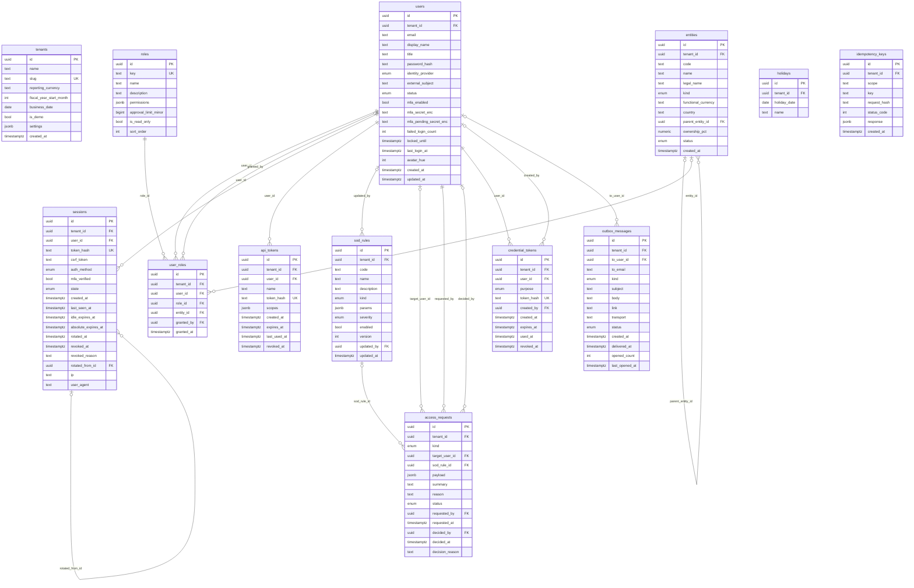

| Table | Ontology class | Notes |
|---|---|---|
| `tenants` | `bh:Organization` | A customer organization. Every business row is scoped to one tenant. |
| `entities` | `bh:ReportingEntity` | A legal or reporting entity with its own functional currency and set of books. |
| `users` | `bh:Person` | A person who signs in. Passwords are scrypt hashes (PHC string); TOTP seeds are encrypted at rest. |
| `roles` | `bh:Role` | A named bundle of permissions with an approval limit (RBAC). |
| `user_roles` |  | Role assignment, optionally scoped to one entity. |
| `sessions` |  | Server-side session (cookie holds an opaque random token). |
| `api_tokens` |  | Personal access token for API/MCP clients; acts with the owner's roles. |
| `sod_rules` | `bh:SegregationOfDutiesRule` | Segregation-of-duties rule enforced by the runtime and checked by the JE review skill. |
| `holidays` |  | Company holidays added to the bank-holiday calendar for workday math. |
| `idempotency_keys` |  | Stored responses for retried mutating requests (Idempotency-Key header). |
| `access_requests` | `bh:AccessRequest` | A change to access or controls held for a second person: a role grant that carries approval authority, or a segregation-of-duties rule change. Applied only when someone other than the requester and the grantee approves it. |
| `credential_tokens` | `bh:CredentialLink` | Single-use, expiring enrolment or password-reset link for one person; only its hash is stored and nobody but the addressee receives it. |
| `outbox_messages` | `bh:OutboxMessage` | Messages Bookhand sends people (enrolment and reset links, lockout notices), queued for the configured transport; a demo organization reads them in its delivery log. |

## Audit

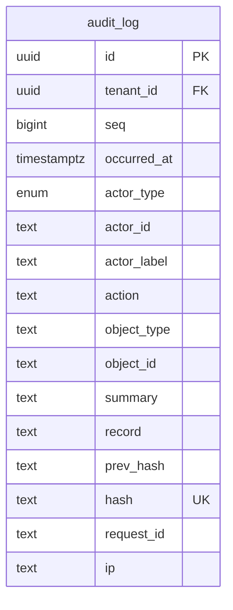

| Table | Ontology class | Notes |
|---|---|---|
| `audit_log` | `bh:AuditEvent` | Tamper-evident, append-only event log. hash = sha256(prev_hash // "\n" // record); the database rejects UPDATE/DELETE and any insert that breaks the chain. **Append-only.** |

## General ledger

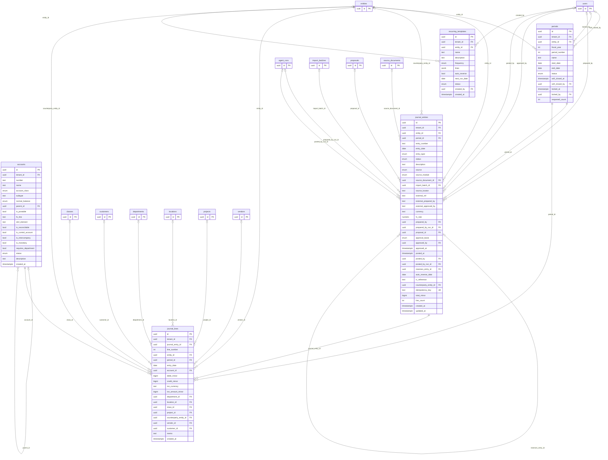

| Table | Ontology class | Notes |
|---|---|---|
| `accounts` | `bh:Account` | Chart of accounts (tenant-wide, shared by entities). Leaf accounts are postable; headers roll up. |
| `periods` | `bh:AccountingPeriod` | Accounting period per entity with its state machine: future -> open -> soft_closed -> locked. |
| `journal_entries` | `bh:JournalEntry` | Journal entry header. Posting is a state transition the database validates (>= 2 lines, debits = credits, period open, dates in period). Posted entries are immutable; corrections are reversing entries. |
| `journal_lines` | `bh:JournalLine` | Journal line: exactly one side positive (debit XOR credit), functional-currency amounts plus the transaction-currency amount. |
| `recurring_templates` | `bh:RecurringEntry` | Template for recurring journal entries (e.g. rent, management fee). |

## Dimensions

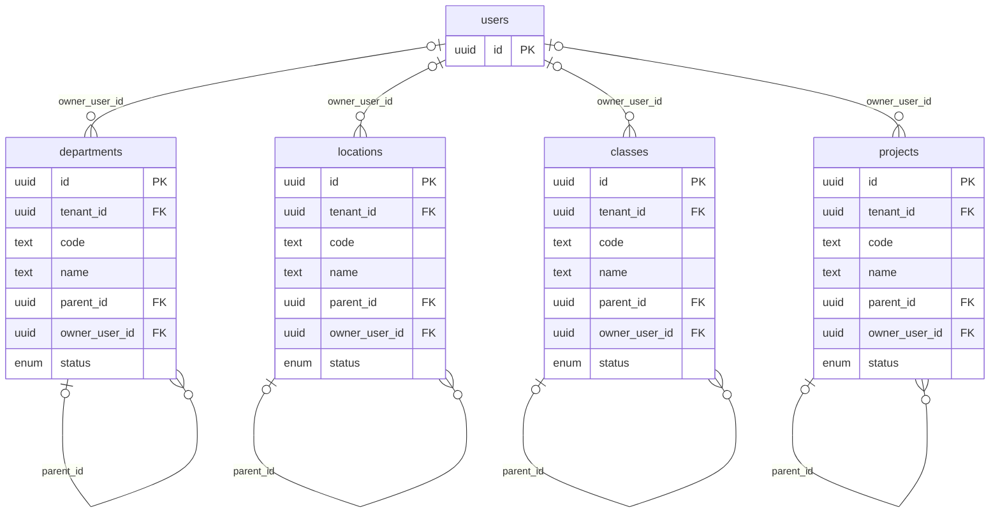

| Table | Ontology class | Notes |
|---|---|---|
| `departments` | `bh:Department` | Cost-center dimension (who spent it). |
| `locations` | `bh:Location` | Geographic dimension (where). |
| `classes` | `bh:BusinessClass` | Classification dimension, e.g. product line. |
| `projects` | `bh:Project` | Project dimension for capitalizable or tracked work. |

## FX

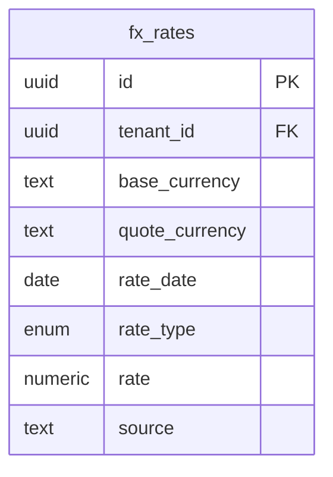

| Table | Ontology class | Notes |
|---|---|---|
| `fx_rates` | `bh:ExchangeRate` | Exchange rates: spot (daily), average (month) and closing (month end). |

## Planning

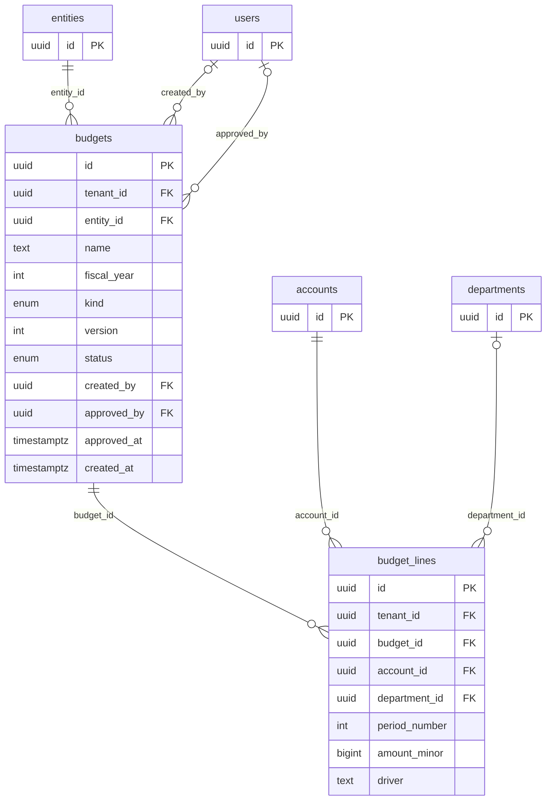

| Table | Ontology class | Notes |
|---|---|---|
| `budgets` | `bh:Budget` | Budget or forecast version for an entity and fiscal year. |
| `budget_lines` |  | Budget amount per account, department and month. |

## Controls

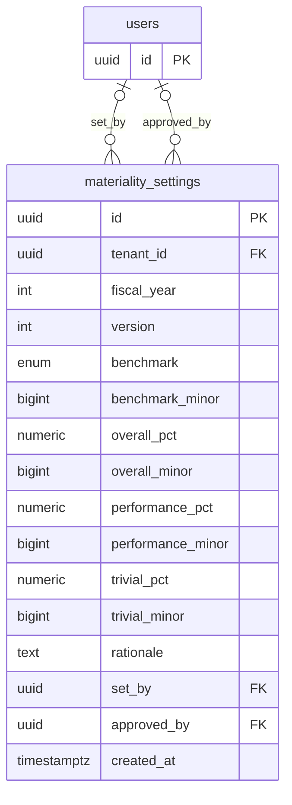

| Table | Ontology class | Notes |
|---|---|---|
| `materiality_settings` | `bh:Materiality` | Materiality: overall, performance and clearly-trivial thresholds (AS 2105 / ISA 320). |

## Accounts payable

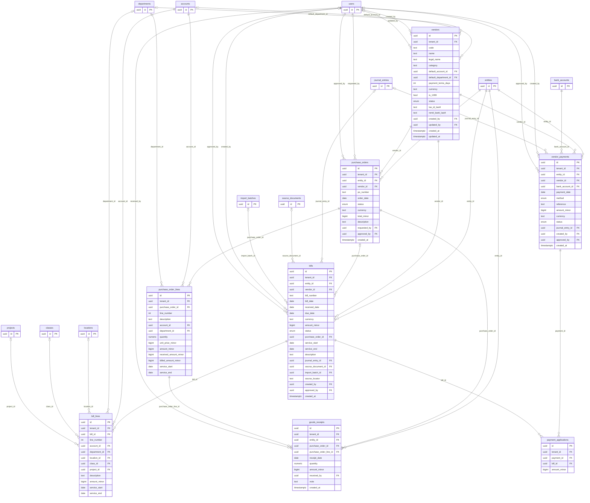

| Table | Ontology class | Notes |
|---|---|---|
| `vendors` | `bh:Vendor` | Vendor master (supplier). |
| `purchase_orders` | `bh:PurchaseOrder` | Purchase order (commitment, REA). |
| `purchase_order_lines` |  | Purchase order line. |
| `goods_receipts` | `bh:GoodsReceipt` | Goods or services received against a PO line (evidence for GRNI accruals). |
| `bills` | `bh:VendorBill` | Vendor bill (invoice received). Posting credits AP and debits the coded accounts. |
| `bill_lines` |  | Bill line with GL coding and dimensions. |
| `vendor_payments` | `bh:VendorPayment` | Outgoing payment to a vendor (economic event: cash disbursement). |
| `payment_applications` |  | Allocation of a payment to the bills it settles. |

## Accounts receivable

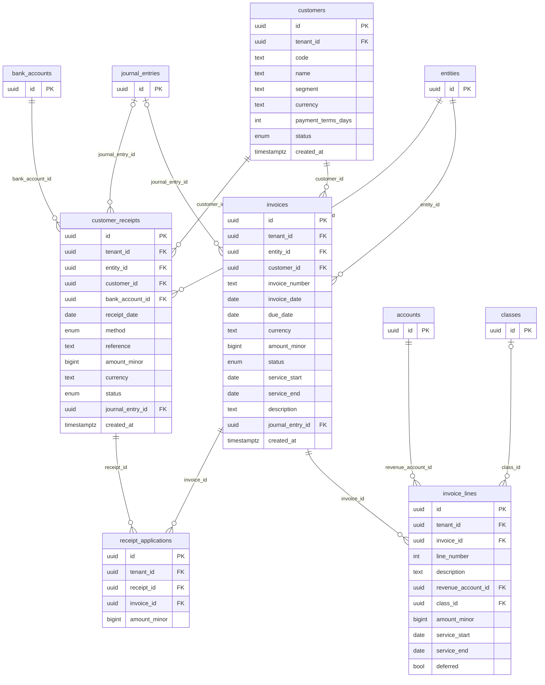

| Table | Ontology class | Notes |
|---|---|---|
| `customers` | `bh:Customer` | Customer master. |
| `invoices` | `bh:CustomerInvoice` | Customer invoice. Subscription invoices create deferred revenue recognized over the service period (ASC 606). |
| `invoice_lines` |  | Invoice line (performance obligation). |
| `customer_receipts` | `bh:CustomerReceipt` | Cash received from a customer. |
| `receipt_applications` |  | Allocation of a receipt to invoices. |

## Cash & cards

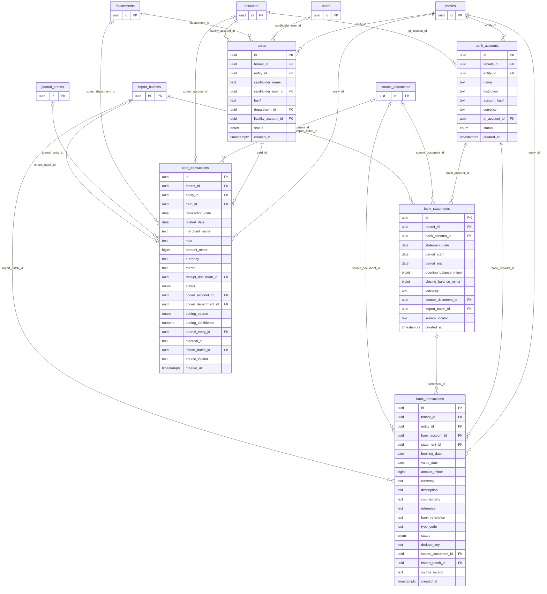

| Table | Ontology class | Notes |
|---|---|---|
| `bank_accounts` | `bh:BankAccount` | Bank account mapped to a GL cash account. |
| `bank_statements` | `bh:BankStatement` | Bank statement (period with opening and closing balances). |
| `bank_transactions` | `bh:BankTransaction` | Bank statement line. Imports are idempotent on (bank account, dedupe key). |
| `cards` | `bh:CorporateCard` | Corporate card. |
| `card_transactions` | `bh:CardTransaction` | Card transaction from the card feed; coded to an account and department before posting. |

## Schedules & payroll

```mermaid
erDiagram
  fixed_assets {
    uuid id PK
    uuid tenant_id FK
    uuid entity_id FK
    text asset_number
    text description
    enum asset_class
    date acquisition_date
    date in_service_date
    bigint cost_minor
    bigint salvage_minor
    int useful_life_months
    enum method
    uuid asset_account_id FK
    uuid accumulated_depreciation_account_id FK
    uuid depreciation_expense_account_id FK
    uuid department_id FK
    uuid location_id FK
    uuid vendor_id FK
    uuid bill_id FK
    enum status
    date disposal_date
    timestamptz created_at
  }
  depreciation_lines {
    uuid id PK
    uuid tenant_id FK
    uuid fixed_asset_id FK
    uuid period_id FK
    int fiscal_year
    int period_number
    bigint amount_minor
    bigint accumulated_minor
    bigint net_book_value_minor
    enum status
    uuid journal_entry_id FK
  }
  amortization_schedules {
    uuid id PK
    uuid tenant_id FK
    uuid entity_id FK
    enum kind
    text description
    uuid vendor_id FK
    uuid customer_id FK
    uuid bill_id FK
    uuid invoice_id FK
    uuid balance_account_id FK
    uuid pl_account_id FK
    uuid department_id FK
    bigint total_minor
    date start_date
    date end_date
    int months
    enum method
    enum status
    uuid created_by FK
    uuid created_by_run_id FK
    timestamptz created_at
  }
  amortization_lines {
    uuid id PK
    uuid tenant_id FK
    uuid schedule_id FK
    uuid period_id FK
    date period_end
    bigint amount_minor
    enum status
    uuid journal_entry_id FK
  }
  payroll_runs {
    uuid id PK
    uuid tenant_id FK
    uuid entity_id FK
    text provider
    text external_id
    date pay_period_start
    date pay_period_end
    date pay_date
    text currency
    bigint gross_minor
    bigint employer_tax_minor
    bigint benefits_minor
    bigint withholding_minor
    bigint net_pay_minor
    int headcount
    uuid journal_entry_id FK
    uuid source_document_id FK
    uuid import_batch_id FK
    timestamptz created_at
  }
  payroll_lines {
    uuid id PK
    uuid tenant_id FK
    uuid payroll_run_id FK
    uuid department_id FK
    enum category
    bigint amount_minor
  }
  accounts {
    uuid id PK
  }
  agent_runs {
    uuid id PK
  }
  bills {
    uuid id PK
  }
  customers {
    uuid id PK
  }
  departments {
    uuid id PK
  }
  entities {
    uuid id PK
  }
  import_batches {
    uuid id PK
  }
  invoices {
    uuid id PK
  }
  journal_entries {
    uuid id PK
  }
  locations {
    uuid id PK
  }
  periods {
    uuid id PK
  }
  source_documents {
    uuid id PK
  }
  users {
    uuid id PK
  }
  vendors {
    uuid id PK
  }
  entities ||--o{ fixed_assets : "entity_id"
  accounts ||--o{ fixed_assets : "asset_account_id"
  accounts ||--o{ fixed_assets : "accumulated_depreciation_account_id"
  accounts ||--o{ fixed_assets : "depreciation_expense_account_id"
  departments |o--o{ fixed_assets : "department_id"
  locations |o--o{ fixed_assets : "location_id"
  vendors |o--o{ fixed_assets : "vendor_id"
  bills |o--o{ fixed_assets : "bill_id"
  fixed_assets ||--o{ depreciation_lines : "fixed_asset_id"
  periods ||--o{ depreciation_lines : "period_id"
  journal_entries |o--o{ depreciation_lines : "journal_entry_id"
  entities ||--o{ amortization_schedules : "entity_id"
  vendors |o--o{ amortization_schedules : "vendor_id"
  customers |o--o{ amortization_schedules : "customer_id"
  bills |o--o{ amortization_schedules : "bill_id"
  invoices |o--o{ amortization_schedules : "invoice_id"
  accounts ||--o{ amortization_schedules : "balance_account_id"
  accounts ||--o{ amortization_schedules : "pl_account_id"
  departments |o--o{ amortization_schedules : "department_id"
  users |o--o{ amortization_schedules : "created_by"
  agent_runs |o--o{ amortization_schedules : "created_by_run_id"
  amortization_schedules ||--o{ amortization_lines : "schedule_id"
  periods ||--o{ amortization_lines : "period_id"
  journal_entries |o--o{ amortization_lines : "journal_entry_id"
  entities ||--o{ payroll_runs : "entity_id"
  journal_entries |o--o{ payroll_runs : "journal_entry_id"
  source_documents |o--o{ payroll_runs : "source_document_id"
  import_batches |o--o{ payroll_runs : "import_batch_id"
  payroll_runs ||--o{ payroll_lines : "payroll_run_id"
  departments |o--o{ payroll_lines : "department_id"
```

| Table | Ontology class | Notes |
|---|---|---|
| `fixed_assets` | `bh:FixedAsset` | Fixed asset register (ASC 360). |
| `depreciation_lines` | `bh:DepreciationScheduleLine` | Depreciation schedule line per asset per period. |
| `amortization_schedules` | `bh:AmortizationSchedule` | Amortization schedule for a prepaid expense (ASC 340) or deferred revenue (ASC 606). |
| `amortization_lines` | `bh:AmortizationScheduleLine` | Monthly amortization amount. |
| `payroll_runs` | `bh:PayrollRun` | Payroll run summary from the payroll provider. |
| `payroll_lines` |  | Payroll cost by department and category. |

## Integration & documents

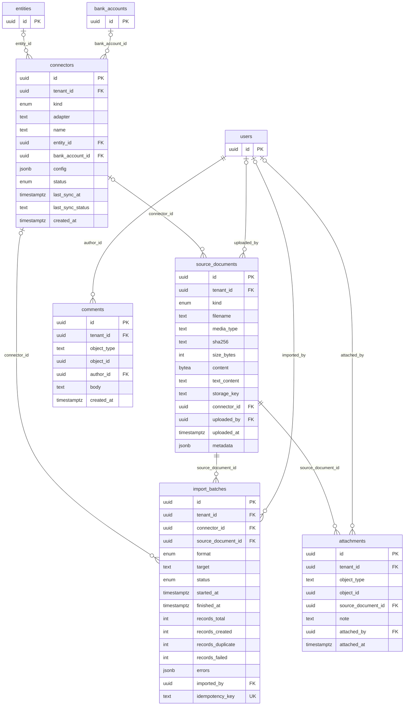

| Table | Ontology class | Notes |
|---|---|---|
| `connectors` | `bh:Connector` | A configured source system (bank feed, ERP export, card feed, payroll...). |
| `source_documents` | `bh:SourceDocument` | Immutable source document (file) identified by its SHA-256; every imported record links back to one. |
| `import_batches` | `bh:ImportBatch` | One import of one source document (idempotent; tracks created/duplicate/failed counts). |
| `attachments` | `bh:Evidence` | Evidence attached to any object (rec, task, JE, proposal). |
| `comments` |  | Discussion on an object. |

## Close management

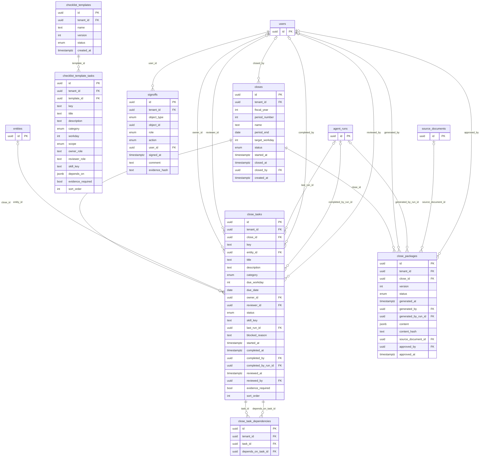

| Table | Ontology class | Notes |
|---|---|---|
| `closes` | `bh:Close` | A month-end close across all entities for one fiscal period. |
| `checklist_templates` | `bh:CloseChecklist` | Versioned close checklist template. |
| `checklist_template_tasks` |  | Task definition in a checklist template. |
| `close_tasks` | `bh:CloseTask` | A task in a specific close, assigned to an owner and reviewer, due on a workday. |
| `close_task_dependencies` |  | Directed dependency between close tasks (must be acyclic). |
| `signoffs` | `bh:SignOff` | Append-only sign-off ledger (preparer/reviewer/approver) for any closeable object. **Append-only.** |
| `close_packages` | `bh:ClosePackage` | Generated close package (TB, statements, commentary, rec and exception status). |

## Reconciliation

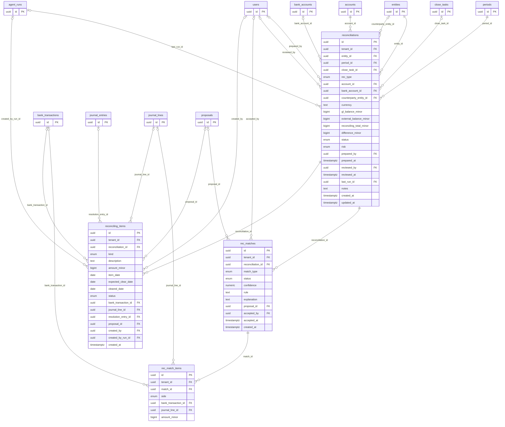

| Table | Ontology class | Notes |
|---|---|---|
| `reconciliations` | `bh:Reconciliation` | Account reconciliation for one period: GL vs. external balance, reconciling items, certification. |
| `rec_matches` | `bh:ReconciliationMatch` | A match group between external items and ledger items. |
| `rec_match_items` |  | Member of a match group (exactly one referenced item). |
| `reconciling_items` | `bh:ReconcilingItem` | Explained difference between GL and external balance (timing or error), with aging. |

## Flux & variance

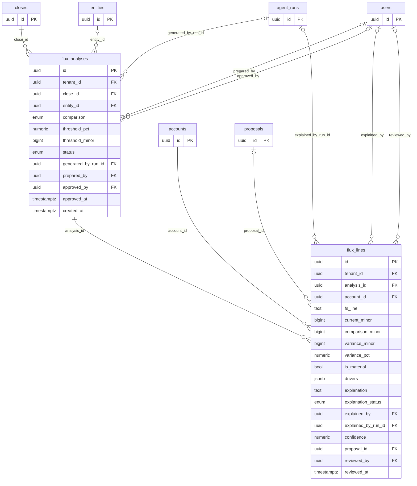

| Table | Ontology class | Notes |
|---|---|---|
| `flux_analyses` | `bh:FluxAnalysis` | Flux (variance) analysis for a close: current vs. comparison with materiality thresholds. |
| `flux_lines` | `bh:FluxLine` | Variance on one account with drivers and an explanation. |

## Agent runtime

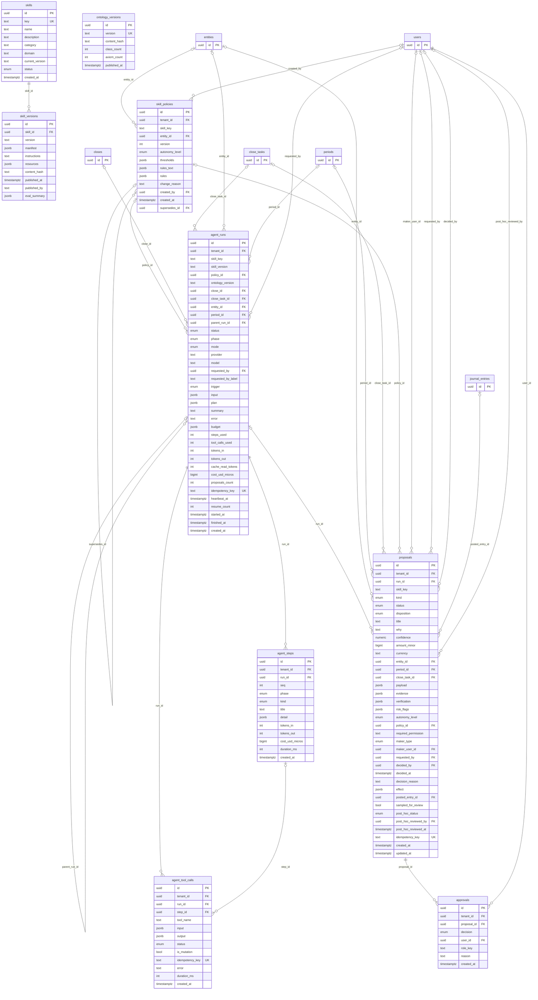

| Table | Ontology class | Notes |
|---|---|---|
| `skills` | `bh:Skill` | Skill registry (global catalog of SKILL.md packages). |
| `skill_versions` |  | Immutable published version of a skill package. **Append-only.** |
| `skill_policies` | `bh:SkillPolicy` | Versioned, append-only tenant policy for a skill: autonomy level, thresholds, plain-English rules. **Append-only.** |
| `agent_runs` | `bh:AgentRun` | One execution of a skill: plan -> act -> observe -> verify -> propose, with budgets and cost accounting. |
| `agent_steps` | `bh:AgentStep` | Trace step of a run (append-only). **Append-only.** |
| `agent_tool_calls` | `bh:ToolCall` | Typed tool call made by an agent (append-only). **Append-only.** |
| `proposals` | `bh:Proposal` | Something an agent (or a person adopting a suggestion) wants to change, with why, confidence, evidence and checks. |
| `approvals` | `bh:ApprovalDecision` | Append-only decision history for proposals (approve, reject, adopt, post-hoc review). **Append-only.** |
| `ontology_versions` |  | Published versions of the close ontology referenced by runs. **Append-only.** |

