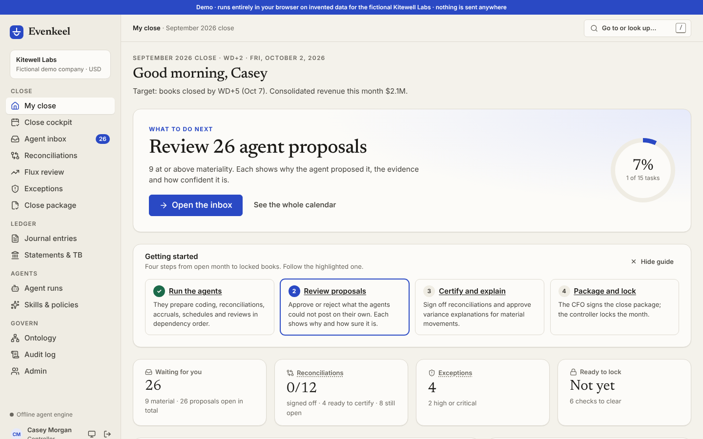
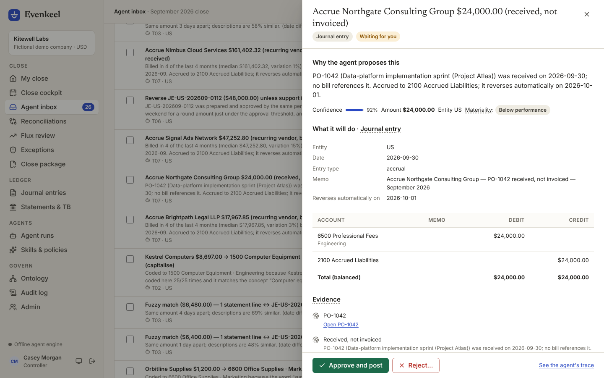
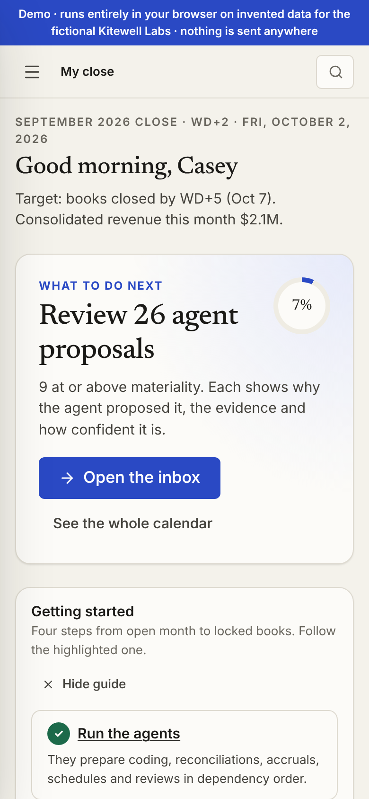
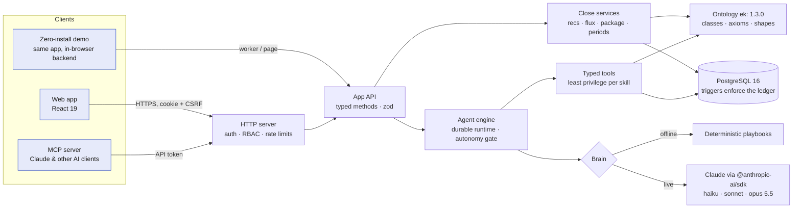
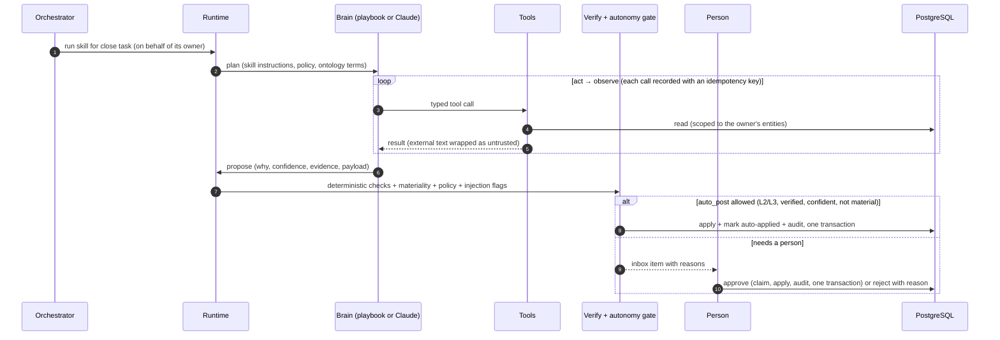

# Evenkeel

**The month-end close, run by AI agents under your controls.** Agents prepare reconciliations, accruals, schedules, variance explanations and the close package. Accountants read the agent's reason, approve or reject, certify and sign. Nothing posts above your policy without a person, and the database itself enforces double entry, maker-checker and immutability.

| My close after the agents ran | Every proposal explains itself | On a phone |
|---|---|---|
|  |  |  |

> Kitewell Labs, its people, vendors and numbers are **fictional**. Evenkeel is an original product with its own brand.

## Try it

### Zero-install demo (one file, nothing sent anywhere)

```bash
npm install && npm run build:demo      # → dist-demo/index.html (≈2.6 MB, self-contained)
```

Open `dist-demo/index.html` directly from disk, or serve it with `npm run preview:demo`. The entire product runs in your browser, on the in-memory store, with the deterministic agent engine:
- the same application code as the server;
- a Web Worker, falling back to the page when workers are blocked;
- hash routing;
- no network calls.

You pick a person to sign in as.

### The full product (server, authentication, PostgreSQL)

```bash
npm run quickstart                     # install, build the web app, start on http://127.0.0.1:4610
```

**Needs:** Node 22.12 or later. Nothing else: without `DATABASE_URL` the server uses **embedded PGlite** (PostgreSQL 16 compiled to WebAssembly) under `.data/`.

**First start:**
- runs the migrations;
- seeds the fictional scenario (about 15–20 s);
- runs the skill evaluations;
- prints the demo accounts.

**Other ways to run it:**
- Use a real PostgreSQL 16 with `DATABASE_URL=postgres://…`.
- With Docker, run `docker compose up --build` (app plus PostgreSQL 16; see [compose.yaml](compose.yaml)).
- `PORT=0` picks a free port; if 4610 is busy, a free one is used and printed.

### Demo logins

Each account gets a strong random password at seed time. It is printed once in the console and saved to `.data/demo-credentials.json` (mode 0600, gitignored). On this machine, outside production, the sign-in page lists the accounts and signs you in with one click, still through the real password check. Set `DEMO_PASSWORD` (12+ characters) for one documented development password instead.

| Person | Role | What to do as them |
|---|---|---|
| casey@kitewell.example | Controller | Runs the close: agents, approvals, lock |
| priya@kitewell.example | Senior Accountant | Reviews reconciliations and agent work |
| sam@kitewell.example | Staff Accountant | Prepares and certifies reconciliations |
| jordan@kitewell.example | CFO | Approves material items, signs the close package |
| miguel@kitewell.example | FP&A Analyst | Explains variances |
| dana@kitewell.example | AP Specialist | Accounts payable |
| alex@auditfirm.example | External Auditor | Read-only, everything |
| taylor@kitewell.example | IT Administrator | Users, roles, segregation of duties |

### The five-minute demo script

1. **Sign in as Casey.** My close says what to do next: *Run the close agents*. "Today" is WD+2 of the September 2026 close.
2. **Run the agents.** The orchestrator dispatches 12 skills in dependency order. Routine, verified items under policy post automatically. 26 proposals wait for people, 9 of them material. The planted issues include:
   - laptops coded to office supplies;
   - an annual subscription that should be a prepaid, and a missed amortisation;
   - a duplicate payment;
   - a weekend round-sum entry just under the approval threshold;
   - unbilled receipts;
   - an intercompany mismatch;
   - a bank memo that tries to instruct the agent.
3. **Review and approve.** Each proposal in the Inbox shows the reason, confidence, evidence, deterministic checks and the exact lines.
   - Bulk-approve the routine items, and reject one with a reason.
   - Nobody approves work an agent prepared on their behalf: the reversal drafted for Priya waits for Casey. Material items need a controller or CFO.
4. **Certify and review the reconciliations.**
   - Sam certifies the reconciliations that tie to zero; Priya reviews them.
   - In Flux review, the agent drafts explanations; someone other than the author approves them.
5. **Disposition the exceptions, then sign and lock.**
   - Generate the close package; Jordan approves it (its numbers are hashed).
   - Casey locks September. The ledger now refuses any posting dated in it.
   - The Audit log verifies the hash chain end to end.

The Playwright suite runs exactly this script against both the server and the static demo.

## What is inside





- **Ontology:** `ek:` v1.3.0, with 157 classes, 55 relations, 31 executable axioms and 46 individuals.
  - Grounded in REA, double entry, XBRL US-GAAP and XBRL GL, FIBO, COSO 2013 / SOX 404, audit assertions, ASC 606/842/340/360 and materiality.
  - Used for proposal shapes, tool typing, verification, bucketing, hover definitions everywhere in the app, and an explorer with a graph.
  - Exported to [Turtle and JSON-LD](docs/ontology/).
- **Database:**
  - PostgreSQL 16 schema in [migrations](db/migrations/), with an [ERD](docs/erd.md).
  - Multi-entity GL (US, UK and an elimination entity) with balancing, immutability, a period state machine, maker-checker, and acyclic task dependencies — all enforced by triggers.
  - A hash-chained, append-only audit log.
  - A contract test keeps the TypeScript table registry and the catalog identical.
- **Connectors:**
  - Real parsers for CSV, **BAI2**, **OFX** and **ISO 20022 camt.053** bank statements, card and payroll CSVs, AP bills and a legacy-ERP journal export.
  - Imports are idempotent (content hashes), and every row keeps its provenance to the source document.
- **Skills:** 12, in Agent-Skills format (`SKILL.md` + manifest), each with eval fixtures run in CI:
  - transaction coding;
  - bank reconciliation (exact, fuzzy, 1:many, many:1, timing);
  - AP/AR tie-outs;
  - accruals;
  - prepaids;
  - depreciation;
  - intercompany and eliminations;
  - FX revaluation;
  - flux;
  - JE anomaly review;
  - orchestration;
  - the close package.

  Each manifest declares ontology-typed inputs and outputs, least-privilege tools, permissions, controls, autonomy bounds, materiality and budgets.
- **Runtime:**
  - Durable, with crash resume by replay.
  - Budgets on steps, tokens and cost.
  - Autonomy levels L0–L3 with hard ceilings.
  - Maker-checker and SoD; three rules can't be disabled.
  - Compare-and-set decisions, so two approvers never apply an item twice.
  - A trace for every run, and a "why" and a confidence on every proposal.
  - Injection hygiene.
- **Security:**
  - scrypt passwords and lockout.
  - HttpOnly, SameSite cookies with rotation and idle/absolute expiry.
  - HMAC CSRF tokens plus Origin checks; token-bucket rate limits.
  - TOTP two-step with replay protection; AES-GCM-sealed secrets.
  - A strict CSP.
  - RBAC with eight roles and entity scoping.
  - An OIDC/SAML provider seam.
  - Every mutation audited.
- **Web:**
  - Screens: My close, Close cockpit, Inbox (bulk approve, reject with reason, undo by reversal), Reconciliation workbench, Flux, Exceptions, Close package, Journal entries and Statements & TB (drill-down to the source file), Agent runs (traces), Skills & policies (plain-English policy editor), Ontology explorer, Audit log, Admin and Account.
  - A guided first run, keyboard shortcuts (`?`), light and dark themes, and phone layouts.
  - Automated WCAG 2.2 AA checks on 50 views.

### Live Claude

Set `ANTHROPIC_API_KEY` and the agents run on Claude through `@anthropic-ai/sdk` (`EVENKEEL_ENGINE=auto|offline|live`):
- **Tool use:** typed tools, with prompt caching of the stable prefix.
- **Model per skill:** `claude-haiku-5-5` (fast), `claude-sonnet-5-5` (balanced) or `claude-opus-5-5` (deep). Override with `EVENKEEL_MODEL_FAST`, `EVENKEEL_MODEL_BALANCED` or `EVENKEEL_MODEL_DEEP`.
- **Same controls:** the same verification, gates and approvals as the offline engine.
- **Testing:** the live path is tested with a scripted client.

### MCP server

Create a token in **Account → API tokens**: read-only or allowed to make changes; it expires and can be revoked. Then point any MCP client at it:

```json
{ "mcpServers": { "evenkeel": { "command": "node", "args": ["<path>/agentic-close/evenkeel/scripts/mcp.mjs"],
  "env": { "EVENKEEL_URL": "http://127.0.0.1:4610", "EVENKEEL_TOKEN": "ekt_…" } } } }
```

**Tools:** 19, including `whats_next`, `list_proposals`, `get_proposal`, `decide_proposals`, `run_close_agents`, `get_reconciliation`, `flux_review`, `trial_balance`, `explain_term` and `verify_audit_chain`.

**Rules:** each call runs as the token's owner, with the same RBAC, SoD, rate limits and audit trail ("Casey Morgan via API token …").

## Quality gates

| Gate | Command | Result (19 Oct 2026, this machine) |
|---|---|---|
| Typecheck | `npm run typecheck` | clean (TypeScript 6.0, strict) |
| Lint | `npm run lint` | 0 problems (typescript-eslint, React hooks, module boundaries) |
| Unit tests | `npm test` | **146 passed** in 12 files: invariants on memory + PGlite, runtime, skills, auth, HTTP, MCP, connectors, close math, … |
| Integration (real DB) | `npm run test:integration` | **27 passed** on PostgreSQL 16.15: invariant suite, schema contract, concurrency, full close through lock |
| Skill evals | `npm run evals` | **64/64** cases across 12 skills (offline engine) |
| End to end | `npm run e2e` | **6 passed**: demo script on the server and on the static demo, three static-demo properties, accessibility (50 views, 0 violations) |
| Dependencies | `npm audit --audit-level=high` | 0 vulnerabilities |

Integration tests start a throwaway PostgreSQL 16 cluster on a random free port under `.data/`. It runs as an unprivileged user when invoked as root, and is stopped and deleted afterwards. Set `DATABASE_URL` to use your own server instead.

CI workflows for these gates and for security scanning are in [.github/workflows](.github/workflows/):
- the gates above;
- Dependency Review, CodeQL security-extended, Semgrep, Gitleaks and TruffleHog.

They live inside this directory, so copy them to the repository root to run them.

## More

- [docs/ASSESSMENT.md](docs/ASSESSMENT.md): what is real and what is simulated, a five-minute tour, a requirement-to-file map and the known gaps.
- [docs/research.md](docs/research.md): Ramp's agent products and ads, the close-software landscape and COSO's GenAI guidance, with sources, and what we built because of it.
- [docs/decisions.md](docs/decisions.md): the decision log.
- [docs/erd.md](docs/erd.md) is the data model. Ontology exports are in [docs/ontology/](docs/ontology/), screenshots in [docs/screenshots/](docs/screenshots/) and ad creatives in [docs/ads/](docs/ads/).
- **Marketing site:** `npm run build:site` builds the landing page with pricing plus the demo into `dist-site/`.

### Scripts

| Command | What it does |
|---|---|
| `npm run quickstart` | Install, build the web app, start the server |
| `npm start` / `npm run dev` | Start the server, or run the server and Vite dev with reload |
| `npm run build:demo` / `build:site` | Build the single-file demo, or the marketing site |
| `npm run db:migrate` / `db:seed` | Run migrations, or seed an empty database |
| `npm run screenshots` / `ads` | Regenerate `docs/screenshots` or `docs/ads` with Playwright |
| `npm run ontology:export` / `docs:erd` | Regenerate the ontology exports or the ERD |
| `npm run mcp` | MCP server on stdio (needs `EVENKEEL_TOKEN`) |

Configuration is documented in [.env.example](.env.example). `npm start` reads `.env` when it exists.

### Layout

```
src/framework/          domain-agnostic: agent runtime, skills, ontology model, store port, LLM adapter
src/packs/accounting/   the accounting domain: ontology, schema, agents and tools, services, seed, evals
src/app/                typed API shared by the server, the in-browser demo and the MCP server
src/server/             HTTP server, authentication, sessions, rate limits, database
src/mcp/                Model Context Protocol server
src/web/                React app (screens, UI kit, demo backend)
skills/                 12 skills: SKILL.md, manifest, resources, eval cases
db/migrations/          PostgreSQL 16 schema and invariants
tests/                  unit, integration (PostgreSQL 16), e2e (Playwright)
```
