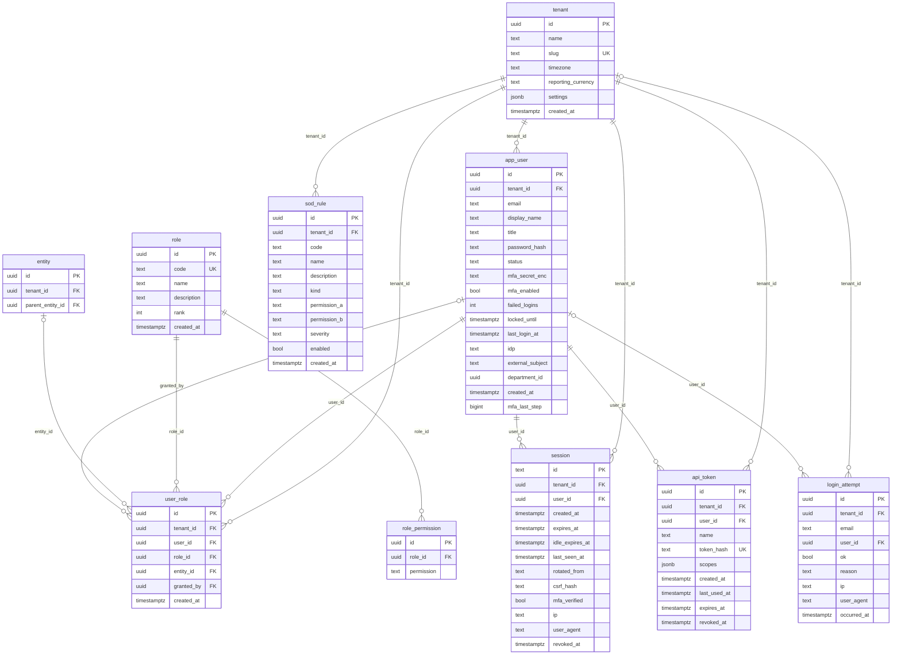
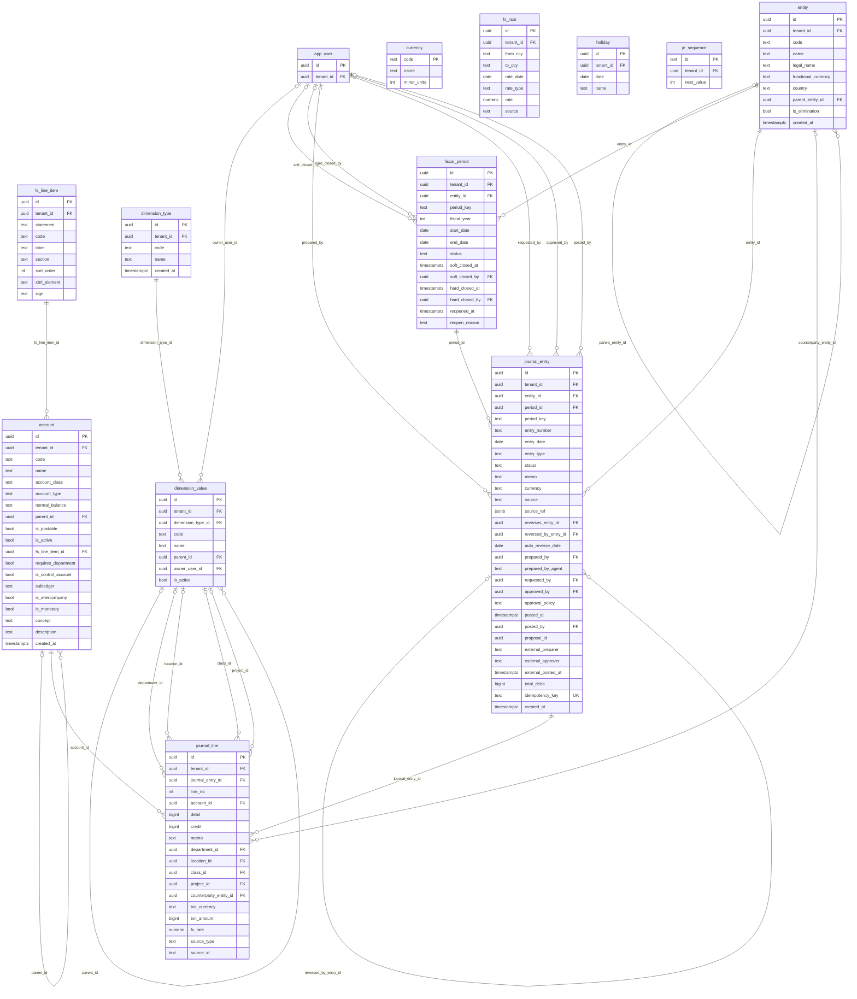
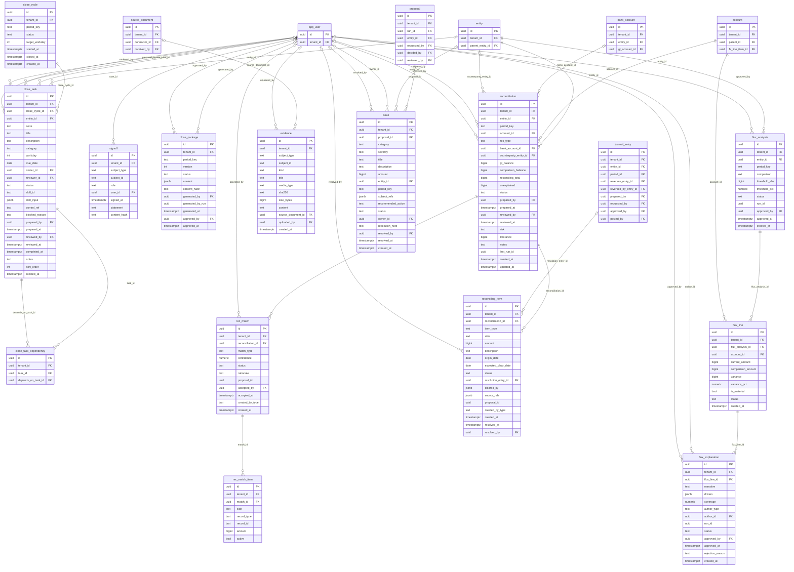
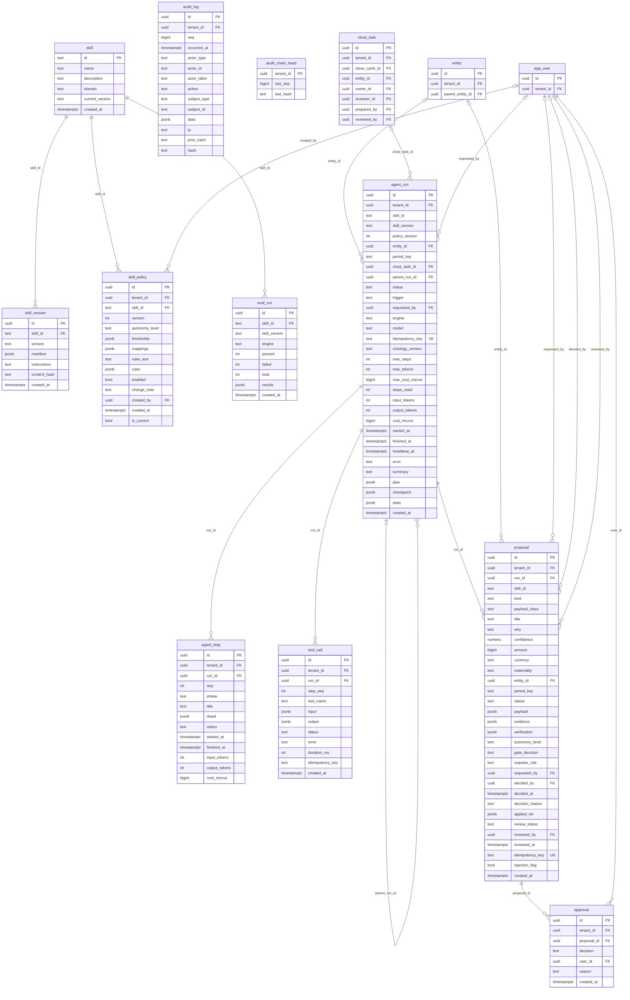

# Evenkeel data model (ERD)

> Generated by `npm run docs:erd` from the table registry in `src/packs/accounting/schema/tables.ts`. The integration suite (`tests/integration/postgres.test.ts`) checks the same registry against the PostgreSQL 16 catalog: tables, columns, types, nullability, enumerations, foreign keys, unique keys, named checks and triggers.

68 tables in five areas. Money is stored as integer minor units (bigint cents). Enumerations are text with named CHECK constraints. Ledger, period, proposal and audit rules are enforced by triggers in `db/migrations/0002_invariants.sql` (see the axiom codes such as EK-DE-01 in the error messages).

Tables from another area appear with their keys only.

## Tenancy, identity and access

Users, roles and permissions (RBAC), segregation-of-duties rules, sessions and API tokens. Every business row carries tenant_id.

## General ledger

Multi-entity, multi-currency double entry. Posting is enforced by triggers: balanced, at least two lines, postable accounts, open period, maker-checker; posted entries are immutable and corrected only by mirror reversals.

## Subledgers and source data

Procure-to-pay, order-to-cash, cash, cards, fixed assets, prepaids, payroll and budgets, with import provenance (connector → import batch → source document).

```mermaid
erDiagram
  vendor {
    uuid id PK
    uuid tenant_id FK
    text name
    text normalized_name
    uuid default_account_id FK
    uuid default_department_id FK
    int payment_terms_days
    bool is_1099
    text status
    text remit_bank_last4
    uuid created_by FK
    uuid updated_by FK
    timestamptz created_at
  }
  purchase_order {
    uuid id PK
    uuid tenant_id FK
    uuid entity_id FK
    uuid vendor_id FK
    text po_number
    date order_date
    text description
    bigint amount
    text currency
    text status
    date received_date
    date service_start
    date service_end
    uuid account_id FK
    uuid department_id FK
    uuid created_by FK
    timestamptz created_at
  }
  bill {
    uuid id PK
    uuid tenant_id FK
    uuid entity_id FK
    uuid vendor_id FK
    text bill_number
    date bill_date
    date due_date
    date received_date
    bigint amount
    text currency
    text status
    date service_start
    date service_end
    uuid po_id FK
    uuid account_id FK
    uuid department_id FK
    text memo
    uuid journal_entry_id FK
    uuid source_document_id FK
    uuid import_batch_id FK
    timestamptz created_at
  }
  vendor_payment {
    uuid id PK
    uuid tenant_id FK
    uuid entity_id FK
    uuid vendor_id FK
    uuid bill_id FK
    date payment_date
    bigint amount
    text method
    text reference
    uuid bank_account_id FK
    uuid journal_entry_id FK
    text status
    uuid created_by FK
    timestamptz created_at
  }
  customer {
    uuid id PK
    uuid tenant_id FK
    text name
    text normalized_name
    int terms_days
    text segment
    timestamptz created_at
  }
  invoice {
    uuid id PK
    uuid tenant_id FK
    uuid entity_id FK
    uuid customer_id FK
    text invoice_number
    date invoice_date
    date due_date
    bigint amount
    text currency
    text status
    uuid revenue_account_id FK
    date service_start
    date service_end
    uuid journal_entry_id FK
    timestamptz created_at
  }
  customer_receipt {
    uuid id PK
    uuid tenant_id FK
    uuid entity_id FK
    uuid customer_id FK
    uuid invoice_id FK
    date receipt_date
    bigint amount
    text method
    text reference
    uuid bank_account_id FK
    text deposit_batch
    uuid journal_entry_id FK
    timestamptz created_at
  }
  bank_account {
    uuid id PK
    uuid tenant_id FK
    uuid entity_id FK
    text name
    text institution
    text account_mask
    text currency
    uuid gl_account_id FK
    timestamptz created_at
  }
  bank_statement {
    uuid id PK
    uuid tenant_id FK
    uuid bank_account_id FK
    text period_key
    date statement_start
    date statement_end
    bigint opening_balance
    bigint closing_balance
    uuid source_document_id FK
    uuid import_batch_id FK
    timestamptz created_at
  }
  bank_transaction {
    uuid id PK
    uuid tenant_id FK
    uuid bank_account_id FK
    uuid statement_id FK
    date posted_date
    date value_date
    bigint amount
    text description
    text reference
    text counterparty
    text type_code
    text external_id
    text status
    text dedupe_hash
    uuid source_document_id FK
    uuid import_batch_id FK
    text source_line
    timestamptz created_at
  }
  card_transaction {
    uuid id PK
    uuid tenant_id FK
    uuid entity_id FK
    text card_last4
    text cardholder_name
    uuid cardholder_user_id FK
    uuid cardholder_department_id FK
    text merchant_name
    text mcc
    bigint amount
    text currency
    date txn_date
    date posted_date
    text memo
    bool receipt_attached
    text status
    uuid account_id FK
    uuid department_id FK
    uuid location_id FK
    uuid class_id FK
    uuid project_id FK
    text coding_source
    numeric coding_confidence
    uuid journal_entry_id FK
    text external_id
    text dedupe_hash
    uuid source_document_id FK
    uuid import_batch_id FK
    timestamptz created_at
  }
  fixed_asset {
    uuid id PK
    uuid tenant_id FK
    uuid entity_id FK
    text tag
    text name
    text asset_class
    date acquisition_date
    date in_service_date
    bigint cost
    bigint salvage
    int useful_life_months
    text method
    uuid asset_account_id FK
    uuid accum_depr_account_id FK
    uuid depr_expense_account_id FK
    uuid department_id FK
    text status
    jsonb source_ref
    timestamptz created_at
  }
  depreciation_line {
    uuid id PK
    uuid tenant_id FK
    uuid fixed_asset_id FK
    text period_key
    bigint amount
    uuid journal_entry_id FK
    text status
  }
  prepaid_schedule {
    uuid id PK
    uuid tenant_id FK
    uuid entity_id FK
    text description
    uuid vendor_id FK
    bigint total
    text start_period
    int months
    uuid prepaid_account_id FK
    uuid expense_account_id FK
    uuid department_id FK
    jsonb source_ref
    text status
    timestamptz created_at
  }
  prepaid_line {
    uuid id PK
    uuid tenant_id FK
    uuid schedule_id FK
    text period_key
    bigint amount
    uuid journal_entry_id FK
    text status
  }
  payroll_run {
    uuid id PK
    uuid tenant_id FK
    uuid entity_id FK
    text provider
    date pay_date
    date period_start
    date period_end
    bigint gross_wages
    bigint employer_taxes
    bigint benefits
    bigint withholdings
    bigint net_pay
    uuid journal_entry_id FK
    uuid source_document_id FK
    uuid import_batch_id FK
    timestamptz created_at
  }
  payroll_line {
    uuid id PK
    uuid tenant_id FK
    uuid payroll_run_id FK
    uuid department_id FK
    bigint gross_wages
    bigint employer_taxes
    bigint benefits
    int headcount
  }
  budget {
    uuid id PK
    uuid tenant_id FK
    uuid entity_id FK
    text name
    int fiscal_year
    text kind
    text version
    text status
    uuid approved_by FK
    timestamptz created_at
  }
  budget_line {
    uuid id PK
    uuid tenant_id FK
    uuid budget_id FK
    uuid account_id FK
    uuid department_id FK
    text period_key
    bigint amount
  }
  connector {
    uuid id PK
    uuid tenant_id FK
    text kind
    text name
    uuid entity_id FK
    uuid bank_account_id FK
    jsonb config
    text status
    timestamptz last_sync_at
    timestamptz created_at
  }
  import_batch {
    uuid id PK
    uuid tenant_id FK
    uuid connector_id FK
    uuid source_document_id FK
    text status
    int created_count
    int duplicate_count
    int error_count
    jsonb errors
    text idempotency_key UK
    timestamptz started_at
    timestamptz finished_at
    uuid started_by FK
  }
  source_document {
    uuid id PK
    uuid tenant_id FK
    uuid connector_id FK
    text filename
    text media_type
    text sha256
    bigint size_bytes
    text content
    timestamptz received_at
    uuid received_by FK
    text parse_status
    int record_count
    text error
  }
  account {
    uuid id PK
    uuid tenant_id FK
    uuid parent_id FK
    uuid fs_line_item_id FK
  }
  app_user {
    uuid id PK
    uuid tenant_id FK
  }
  dimension_value {
    uuid id PK
    uuid tenant_id FK
    uuid dimension_type_id FK
    uuid parent_id FK
    uuid owner_user_id FK
  }
  entity {
    uuid id PK
    uuid tenant_id FK
    uuid parent_entity_id FK
  }
  journal_entry {
    uuid id PK
    uuid tenant_id FK
    uuid entity_id FK
    uuid period_id FK
    uuid reverses_entry_id FK
    uuid reversed_by_entry_id FK
    uuid prepared_by FK
    uuid requested_by FK
    uuid approved_by FK
    uuid posted_by FK
  }
  account |o--o{ vendor : "default_account_id"
  dimension_value |o--o{ vendor : "default_department_id"
  app_user |o--o{ vendor : "created_by"
  app_user |o--o{ vendor : "updated_by"
  entity ||--o{ purchase_order : "entity_id"
  vendor ||--o{ purchase_order : "vendor_id"
  account |o--o{ purchase_order : "account_id"
  dimension_value |o--o{ purchase_order : "department_id"
  app_user |o--o{ purchase_order : "created_by"
  entity ||--o{ bill : "entity_id"
  vendor ||--o{ bill : "vendor_id"
  purchase_order |o--o{ bill : "po_id"
  account |o--o{ bill : "account_id"
  dimension_value |o--o{ bill : "department_id"
  journal_entry |o--o{ bill : "journal_entry_id"
  source_document |o--o{ bill : "source_document_id"
  import_batch |o--o{ bill : "import_batch_id"
  entity ||--o{ vendor_payment : "entity_id"
  vendor ||--o{ vendor_payment : "vendor_id"
  bill |o--o{ vendor_payment : "bill_id"
  bank_account ||--o{ vendor_payment : "bank_account_id"
  journal_entry |o--o{ vendor_payment : "journal_entry_id"
  app_user |o--o{ vendor_payment : "created_by"
  entity ||--o{ invoice : "entity_id"
  customer ||--o{ invoice : "customer_id"
  account ||--o{ invoice : "revenue_account_id"
  journal_entry |o--o{ invoice : "journal_entry_id"
  entity ||--o{ customer_receipt : "entity_id"
  customer ||--o{ customer_receipt : "customer_id"
  invoice |o--o{ customer_receipt : "invoice_id"
  bank_account ||--o{ customer_receipt : "bank_account_id"
  journal_entry |o--o{ customer_receipt : "journal_entry_id"
  entity ||--o{ bank_account : "entity_id"
  account ||--o{ bank_account : "gl_account_id"
  bank_account ||--o{ bank_statement : "bank_account_id"
  source_document |o--o{ bank_statement : "source_document_id"
  import_batch |o--o{ bank_statement : "import_batch_id"
  bank_account ||--o{ bank_transaction : "bank_account_id"
  bank_statement |o--o{ bank_transaction : "statement_id"
  source_document |o--o{ bank_transaction : "source_document_id"
  import_batch |o--o{ bank_transaction : "import_batch_id"
  entity ||--o{ card_transaction : "entity_id"
  app_user |o--o{ card_transaction : "cardholder_user_id"
  dimension_value |o--o{ card_transaction : "cardholder_department_id"
  account |o--o{ card_transaction : "account_id"
  dimension_value |o--o{ card_transaction : "department_id"
  dimension_value |o--o{ card_transaction : "location_id"
  dimension_value |o--o{ card_transaction : "class_id"
  dimension_value |o--o{ card_transaction : "project_id"
  journal_entry |o--o{ card_transaction : "journal_entry_id"
  source_document |o--o{ card_transaction : "source_document_id"
  import_batch |o--o{ card_transaction : "import_batch_id"
  entity ||--o{ fixed_asset : "entity_id"
  account ||--o{ fixed_asset : "asset_account_id"
  account ||--o{ fixed_asset : "accum_depr_account_id"
  account ||--o{ fixed_asset : "depr_expense_account_id"
  dimension_value |o--o{ fixed_asset : "department_id"
  fixed_asset ||--o{ depreciation_line : "fixed_asset_id"
  journal_entry |o--o{ depreciation_line : "journal_entry_id"
  entity ||--o{ prepaid_schedule : "entity_id"
  vendor |o--o{ prepaid_schedule : "vendor_id"
  account ||--o{ prepaid_schedule : "prepaid_account_id"
  account ||--o{ prepaid_schedule : "expense_account_id"
  dimension_value |o--o{ prepaid_schedule : "department_id"
  prepaid_schedule ||--o{ prepaid_line : "schedule_id"
  journal_entry |o--o{ prepaid_line : "journal_entry_id"
  entity ||--o{ payroll_run : "entity_id"
  journal_entry |o--o{ payroll_run : "journal_entry_id"
  source_document |o--o{ payroll_run : "source_document_id"
  import_batch |o--o{ payroll_run : "import_batch_id"
  payroll_run ||--o{ payroll_line : "payroll_run_id"
  dimension_value ||--o{ payroll_line : "department_id"
  entity ||--o{ budget : "entity_id"
  app_user |o--o{ budget : "approved_by"
  budget ||--o{ budget_line : "budget_id"
  account ||--o{ budget_line : "account_id"
  dimension_value |o--o{ budget_line : "department_id"
  entity |o--o{ connector : "entity_id"
  bank_account |o--o{ connector : "bank_account_id"
  connector |o--o{ import_batch : "connector_id"
  source_document ||--o{ import_batch : "source_document_id"
  app_user |o--o{ import_batch : "started_by"
  connector |o--o{ source_document : "connector_id"
  app_user |o--o{ source_document : "received_by"
```

## Close management

The close calendar and its task graph (acyclic by trigger), reconciliations with matches and reconciling items, flux analysis, evidence, sign-offs and the close package.

## Agents, skills and audit

Durable agent runs (steps, tool calls, proposals, human approvals), versioned skills and policies, evaluation results, and the hash-chained, append-only audit log.

Every tenant-scoped table also references `tenant(id)`; those edges are drawn only in the first diagram to keep the others readable.
