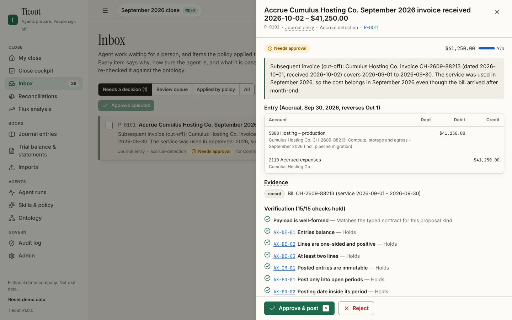
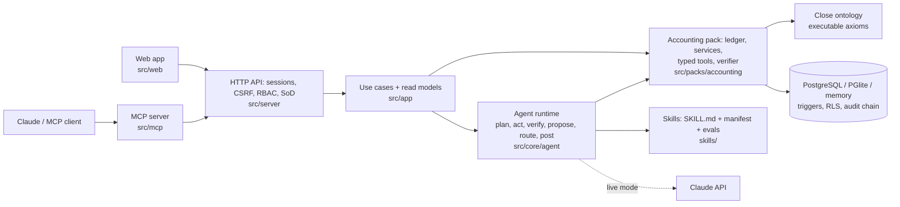

# Tieout — the agentic month-end close

**Agents prepare. People sign off.** Tieout runs the month-end close with AI agents that reconcile
the bank, code card spend, find missing accruals, roll schedules, match intercompany, remeasure FX,
review risky entries and draft flux commentary. Every item arrives with a plain-English reason, a
confidence and the evidence behind it, checked against an executable accounting ontology. The
Controller decides, per skill, what may post on its own; everything else waits for the right person,
with segregation of duties, approval limits and a tamper-evident audit trail enforced by the app and
by the database.

> All demo data belongs to **Bramblewood Labs, a fictional company** (US parent, UK subsidiary).
> Names, vendors, banks and amounts are made up.



## Try it

| | Command | What you get |
|---|---|---|
| **Zero-install demo** | `npm run setup && npm run build:demo` | `dist/demo/index.html`: the whole product (API, agents on the offline engine, web app) in one self-contained page. Open it from disk, host it anywhere, or embed it in a sandboxed iframe. No server, no network, nothing persists. |
| **Local server** | `npm run setup && npm start` | Builds the web app and starts the server on a random free port (printed), with embedded PostgreSQL (PGlite) in `.data/` and the demo company seeded on first run. Set `PORT` for a fixed port. |
| **Development** | `npm run dev` | API (watch mode) + Vite with hot reload, each on a random free port. |
| **PostgreSQL** | `DATABASE_URL=postgres://… npm start` | Production database. Use an ordinary role (not a superuser) so row-level security applies; `compose.yaml` shows a complete setup. |
| **Landing page** | `npm run build:site` | `dist/site/`: the marketing page with the demo inside. |

Node 22.6+ is required. Every port is configurable and defaults to a random free one.

**Demo sign-in.** The sign-in page lists the fictional people; click one. They share one
**dev-only** password, `close-the-books`, used only when `DEMO_PASSWORD` is not set (never deploy it).

| Person | Role | Try |
|---|---|---|
| Jordan Lee | Senior Accountant | Run the close agents, triage the inbox |
| Casey Morgan | Controller | Approve entries, set skill autonomy and rules, lock the period |
| Riley Chen | CFO | Approve what exceeds the Controller's limit (the payroll accrual) |
| Sam Rivera | Staff Accountant | Code transactions, prepare reconciliations |
| Priya Natarajan | AP Specialist | Vendor-side work |
| Devon Park | FP&A Analyst | Read flux, draft explanations |
| Alex Quinn | External Auditor | Read-only: ledger, runs, audit chain |
| Avery Stone | IT Administrator | People, roles and entity scope (e.g. limit Sam to the UK subsidiary), SoD controls, security settings |

## Demo script (≈5 minutes for the tour, ≈10 to finish the close)

The same story, all the way to the locked period, runs as the end-to-end test suite
(`tests/e2e/demo-script.spec.ts`), against the server (on embedded PostgreSQL) and against the static
demo.

1. **Sign in as Jordan Lee.** *My close* shows the September 2026 close at **WD+2** with the agents not
   yet run.
2. **Run close agents.** Nine checklist tasks run in three dependency waves (coding before accruals,
   FX before eliminations) across both entities on the offline engine: about a second in the static
   demo, ten on the server's embedded Postgres. Small, certain items are applied within the
   Controller's policy and sampled for review; the rest lands in the inbox.
3. **Inbox → search "Riverside".** A $9,800 wire whose bank memo tries to instruct "AI agents" to
   auto-approve everything: the text is **[withheld]**, the item is flagged *Instruction-like text* and
   held for a person.
4. **Open "Accrue Cumulus Hosting…".** Jordan cannot approve it: *"You ran the agent that prepared this,
   so a different person has to approve it"* (SOD-02).
5. **Sign out, sign in as Casey Morgan, approve the accrual.** It posts with its reason, evidence and
   approval trail; its reversal posts automatically on October 1.
6. **The payroll accrual ($459,094)** shows *for CFO*: above the Controller's approval limit.
7. **Reconciliations → First Harbor → Open workbench.** The tie-out bridge: statement balance, deposit
   in transit, outstanding check, and the unexplained −$2,750 that keeps it from tying out.
8. **Flux → 6310 Events and conferences.** Drivers that add up exactly to +$102,141; approve the
   drafted explanation.
9. **Skills & policy → Transaction coding.** Type *"Never auto-post anything over $2,000"*; Tieout shows
   how it read the rule before you save it as a new policy version.
10. **Hover any underlined term** for its ontology definition; **Ontology → Axioms** for the rules.
11. **Audit log → Verify chain**, then **Close cockpit**: the period cannot lock while work is open
    (AX-CL-02).

**Finish the close:**

12. **Decide everything (Casey).** *Inbox → Select all I can approve → Approve*. Items flagged for
    instruction-like text never join a bulk selection: open the Riverside wire and reject it with a
    reason. Then **Riley Chen (CFO)** approves what is above Casey's limit, such as the payroll accrual.
13. **Certify the reconciliations (Sam Rivera).** In each bank workbench, *Certify as preparer*; the open
    $2,750 needs a written justification (AX-REC-04). Certify the AP/AR tie-outs too; the duplicate
    payment needs a note.
14. **Explain the new variances (Sam).** Posting the payroll accrual pushed two payroll accounts past
    the threshold: write one explanation yourself (*Flux → the row → Your explanation*) and let the
    agent draft the other (*Draft 1 explanation*).
15. **Casey** approves the explanations, *Review & sign*s each reconciliation, signs off the checklist and
    clicks *Draft close package*.
16. **Riley** approves the package draft in the inbox, *Finalize & sign*s it in the close cockpit, then
    **Lock September 2026**. A locked entity can be reopened only with a documented reason.

**Planted in the books** (what the agents should find): a deposit in transit ($27,500), an outstanding
check (#10452, $1,236.40), a bank fee and interest, an unexplained bank debit ($2,750), the
prompt-injection wire; 29 uncoded card charges, a hosting charge booked to the wrong account ($6,880),
an instrument that should be capitalized ($14,250); a subsequent invoice ($41,250), a recurring vendor
with no bill ($13,037), goods received not invoiced ($48,000), 13 days of unpaid payroll; due
depreciation and prepaid amortization; an AP debit balance from a duplicate payment ($18,400); a
missing intercompany charge (£18,500) and the eliminations; a GBP remeasurement loss ($3,840); a
self-approved Sunday journal entry; and six significant P&L variances across both entities.

## What's inside

* **Ten close skills** (`skills/`): bank reconciliation, transaction coding, accrual detection,
  schedule roll-forward, subledger tie-out, intercompany matching, FX remeasurement, journal-entry
  risk review, flux analysis, close package. Each is a `SKILL.md` procedure with a typed manifest
  (inputs, outputs, permissions, controls, autonomy default and maximum, budgets, model) and golden
  evals that run in CI.
* **Durable agent runtime** (`src/core/agent`): plan → act → observe → verify → propose → route →
  post → audit; idempotent, crash-resumable, budgeted, least-privilege; live Claude (`@anthropic-ai/sdk`,
  model per skill) or a deterministic offline engine with the same verifier and controls.
* **Close ontology** (`src/packs/accounting/ontology`): 245 classes, 75 relations, 39 executable axioms,
  264 terms, 41 sources; validates proposals, grounds prompts, drives coding signals, explains terms in
  the UI; exports as OWL in JSON-LD and Turtle (`docs/ontology/`).
* **Ledger and controls**: double-entry ledger in minor units, multi-entity with consolidation (closing
  and average rates, CTA, eliminations), close checklist with workday calendar, reconciliations, flux,
  close package with hashed sign-off; database triggers enforce balanced, immutable entries, open
  periods, maker-checker and the hash-chained audit log, which auditors can export and verify outside
  the app (`npm run verify:audit -- file.json`); row-level security isolates tenants.
* **Enterprise auth**: scrypt, server-side sessions, CSRF + Origin checks, rate limits, RBAC (8 roles,
  34 permissions) with SoD and approval limits, TOTP MFA with recovery codes, OpenID Connect SSO,
  entity scoping, administrator resets of passwords and two-factor, API tokens for MCP.
* **Integrations**: BAI2, ISO 20022 camt.053, OFX and CSV bank statements; card, ERP journal, AP and
  payroll files; idempotent by content hash with per-record provenance.
* **MCP server** (`src/mcp`): Claude can read the close and start agent runs with a read-only token.
* **Accessible web app** (`src/web`): WCAG 2.2 AA checked with axe in light and dark mode, keyboard
  shortcuts (`?`), responsive down to phones.

## Quality gates

```bash
npm run verify          # gen:check, typecheck, lint, unit + integration tests, skill evals
npm run pg:start        # throwaway PostgreSQL 16 cluster in .pgtest/ (random port) for the PG tests
npm run test:integration
npm run e2e             # Playwright: the demo script to the locked period, scope, 2FA, axe (server on PGlite)
npm run e2e:demo        # Playwright: the static demo from disk, in a sandboxed iframe, offline, phone
npm run audit:deps      # npm audit --audit-level=high
npm run pg:stop
```

Playwright uses the browsers in `PLAYWRIGHT_BROWSERS_PATH`. Latest results are in
[`docs/ASSESSMENT.md`](docs/ASSESSMENT.md). A GitHub Actions pipeline running all of the above against
a PostgreSQL 16 service is in [`ci/github-actions.yml`](ci/github-actions.yml) (kept in this folder;
copy it to `.github/workflows/` to enable it).

## Live Claude and MCP

* **Live agents:** set `ANTHROPIC_API_KEY`. Runs default to live when a key is present; `POST /api/runs`
  accepts `mode: "offline"` to force the deterministic engine. Models: Opus 5.5 for accruals,
  journal-entry review and the close package; Sonnet 5.5 for reconciliations, intercompany, subledgers
  and flux; Haiku 5.5 for coding, schedules and FX.
* **MCP:** create a token in *Admin → My account → API tokens*, then run
  `TIEOUT_URL=http://127.0.0.1:<port> TIEOUT_API_TOKEN=tko_… npm run mcp` as an MCP stdio server.

## Configuration

All settings are environment variables with safe local defaults; see [`.env.example`](.env.example).
In production set `DATABASE_URL`, `APP_ENCRYPTION_KEY`, `PUBLIC_ORIGIN` (https), `SEED_DEMO=false`,
and optionally `OIDC_ISSUER`, `OIDC_CLIENT_ID`, `OIDC_REDIRECT_URI` (`…/api/auth/oidc/callback`) and
`OIDC_CLIENT_SECRET`. `docker compose up` builds the image and runs it against PostgreSQL 16 as an
ordinary role (`compose.yaml`, `deploy/initdb/`).

## Architecture



The same app (API, agents, ontology) runs on the Node server and inside the static demo page. Details in
[`docs/architecture.md`](docs/architecture.md).

## Layout

```
migrations/          SQL schema (source of truth), triggers, row-level security
skills/<key>/        SKILL.md + resources/ + evals/golden.json
src/core/            framework: store, audit, auth, ontology engine, skills, agent runtime, LLM
src/packs/accounting ledger, services, controls, ontology, tools, brains, verifier, seed, evals
src/app/             use cases and read models
src/server/          HTTP API (Hono) and Node entry
src/web/             React app        src/demo/   in-page demo boot        src/mcp/   MCP server
scripts/             codegen, dev, builds, db, evals, screenshots, ads, Postgres test cluster
ci/                  CI pipeline template          deploy/   database init for compose
tests/               unit/, integration/, e2e/, e2e-demo/
docs/                research, architecture, decisions, assessment, ERD, ontology exports, screenshots, ads
site/                landing page
```

## Documentation

[Research](docs/research.md) · [Architecture](docs/architecture.md) · [Data model](docs/erd.md) ·
[Decisions](docs/decisions.md) · [Assessment](docs/ASSESSMENT.md) · [Ad creatives](docs/ads/)
