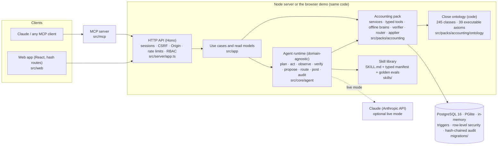

# Architecture

Tieout is one TypeScript code base with three layers and one rule: **agents prepare, people (or a
Controller-signed policy) apply**. The same HTTP application runs in the Node server and, unchanged,
inside the zero-install static demo.



## Layers

| Layer | Path | Responsibility |
|---|---|---|
| Framework core | `src/core` | Store abstraction and drivers, audit chain, auth primitives (scrypt, TOTP, OIDC), ontology engine, skills loader and policies, agent runtime, autonomy router, orchestration, LLM providers. Knows nothing about accounting (enforced by an ESLint layering rule). |
| Accounting pack | `src/packs/accounting` | Ledger (posting, balances, statements, consolidation), services (matching, coding, accruals, schedules, intercompany, FX, flux, anomaly, close), controls (permissions, roles, SoD), the ontology module, 20 read tools and 7 propose tools, offline brains, verifier, assessment, applier, seed scenario, eval harness. |
| Application | `src/app` | Use cases (auth, proposals, close, recs, ledger, skills, admin, imports) and screen-shaped read models, all permission-checked and entity-scoped. |
| Delivery | `src/server`, `src/web`, `src/demo`, `src/mcp` | HTTP API and Node entry, React app, in-page demo boot, MCP server. |
| Schema | `migrations/*.sql` → `src/schema/*.generated.ts` | SQL is the source of truth; `npm run gen` derives row types and table metadata; `npm run gen:check` fails CI on drift. |

## The agent loop

```mermaid
sequenceDiagram
  autonumber
  participant P as Person or orchestrator
  participant R as Runtime
  participant B as Brain (offline) or Claude (live)
  participant T as Typed tools (read)
  participant V as Verifier (ontology axioms)
  participant Q as Router (autonomy policy)
  participant A as Applier
  participant D as Database + audit chain
  P->>R: start run (skill, entity, period) — idempotency key
  R->>D: run row, policy snapshot, audit "agent.run.create"
  loop until the brain finishes or a budget is hit
    B->>R: plan / tool call / propose
    R->>T: call with the requester's permissions ∩ the skill's manifest
    T-->>R: result (untrusted text scanned, wrapped as data)
    R->>D: step + tool result recorded (replayable)
    R->>V: verify each draft (balance, periods, accounts, evidence…)
    V-->>R: checks; failures are rejected and fed back
    R->>Q: route (L0–L3, ceiling, confidence, flags, materiality)
    alt policy may apply
      Q->>A: apply as "policy" (sampled or full post-hoc review)
      A->>D: post entry / confirm match (triggers re-check invariants)
    else a person decides
      Q-->>D: proposal waits in the inbox with why, confidence, evidence
    end
  end
  R->>D: summary, cost, audit "agent.run.succeeded"
```

* **Durability.** Every action is recorded as it completes. A crashed run resumes by replaying its
  brain against the recorded tool results; proposals carry idempotency keys
  (`skill:entity:period:dedupeKey`), so a replay never duplicates work (`tests/unit/runtime.test.ts`).
* **Least privilege.** A skill sees only its `allowed-tools`; each call is checked against the
  requesting person's permissions intersected with the manifest's. There is no approve, post or pay
  tool (AX-AGT-03).
* **Live and offline.** Live mode drives the same tools through Claude's tool use (typed JSON schemas
  generated from zod, model chosen per skill); the offline engine is deterministic TypeScript. Both
  share the verifier, router, applier and audit, and the golden evals run offline in CI.
* **Orchestration.** The close checklist is a DAG; `runCloseAgents` plans Kahn waves, fans skills out
  per entity, skips work whose prerequisites failed, and updates the checklist.

## Security model (summary)

| Concern | Mechanism | Where |
|---|---|---|
| Sessions | 256-bit random token in an HttpOnly, SameSite=Strict, Secure (prod) cookie; only SHA-256 stored; idle + absolute expiry; rotation after MFA; until two-factor is finished a session can only finish it | `src/app/auth.ts`, `src/server/app.ts` |
| CSRF | Token = HMAC(session token) checked on every mutation (hash stored), plus Origin check | `src/server/app.ts` |
| Passwords | scrypt (N=2¹⁵, r=8, p=3), PHC strings, rehash on login, lockout, per-IP and per-account rate limits | `src/core/auth/password.ts` |
| MFA | TOTP (RFC 6238, wall-clock time) with replay protection; secrets AES-256-GCM encrypted at rest; ten one-time recovery codes stored as hashes; administrator reset with a documented reason | `src/core/auth/totp.ts`, `src/core/auth/recovery.ts`, `src/app/admin.ts` |
| SSO | OpenID Connect code flow + PKCE, ID tokens verified against JWKS | `src/core/auth/oidc.ts` |
| Authorization | RBAC (8 roles, 34 permissions), entity scoping, SoD rules, approval limits, maker-checker also as a DB trigger | `src/packs/accounting/controls`, `migrations/0002_accounting.sql` |
| Tenant isolation | Store-level scoping plus PostgreSQL row-level security (FORCE) on every tenant table | `src/core/store/postgres.ts`, `migrations/0003_tenant_rls.sql` |
| Integrity | Balanced, immutable entries; open periods; hash-chained append-only audit log | triggers in `migrations/`, `src/core/audit/chain.ts` |
| Prompt injection | Untrusted-text scanning, redaction in titles, data-boundary wrapping, flagged items forced to a person | `src/core/agent/injection.ts` |
| Transport/browser | Strict CSP, `frame-ancestors 'none'`, nosniff, no-referrer, COOP/CORP | `src/server/app.ts` |

## Deployment shapes

* **Local dev:** `npm run dev` (API + Vite on random ports, embedded PGlite in `.data/`).
* **Server:** `npm start` (or `npm run build && npm run start:prod`) with `DATABASE_URL` for PostgreSQL.
  Run as an ordinary database role so row-level security applies (`compose.yaml` shows how).
* **Zero-install demo:** `npm run build:demo` → `dist/demo/index.html`, one self-contained page.
* **Marketing site:** `npm run build:site` → `dist/site/` with the demo under `demo/`.

The data model is documented in [`docs/erd.md`](erd.md) (generated from the schema).
