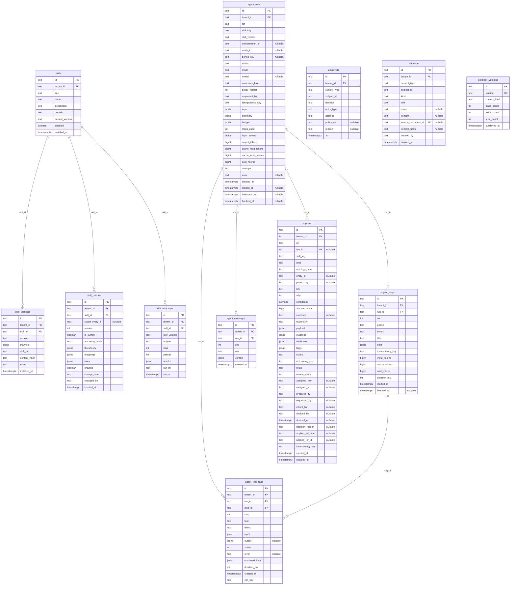

# Data model (generated)

Generated by `npm run docs:erd` from the schema metadata, which `npm run gen` derives from `migrations/*.sql`. 81 tables. Money is stored in integer minor units; JSON columns are typed in `src/schema/json-types.ts`. Foreign keys to `tenants` are omitted from the diagrams for readability: every tenant-scoped table has one.

## Tenancy, identity and controls

Every tenant table carries tenant_id (row-level security, migrations 0003 and 0010); the tenant directory maps a sign-in email, session, API-token or credential-link hash to its tenant, nothing more. Sessions and invitation/reset links store only a SHA-256 of the token; MFA secrets and outbox message bodies are AES-256-GCM encrypted; a grant of approval authority or an SoD change is an access request that a second person decides (migration 0012); the audit log is hash-chained, append-only and re-hashed by the database on insert (AX-AUD-01).

```mermaid
erDiagram
  roles ||--o{ role_permissions : "role_id"
  permissions ||--o{ role_permissions : "permission_id"
  users ||--o{ user_roles : "user_id"
  roles ||--o{ user_roles : "role_id"
  users ||--o{ sessions : "user_id"
  users ||--o{ mfa_factors : "user_id"
  users ||--o{ mfa_recovery_codes : "user_id"
  users ||--o{ api_tokens : "user_id"
  users ||--o{ credential_links : "user_id"
  users |o--o{ outbox_messages : "to_user_id"
  users |o--o{ access_requests : "subject_user_id"
  users ||--o{ access_requests : "requested_by"
  users |o--o{ access_requests : "decided_by"
  tenants {
    text id PK
    text slug UK
    text name
    boolean is_demo
    jsonb settings
    timestamptz created_at
  }
  tenant_directory {
    text id PK
    text tenant_id FK
  }
  users {
    text id PK
    text tenant_id FK
    text email UK
    text display_name
    text title "nullable"
    text password_hash "nullable"
    text status
    text kind
    boolean mfa_enabled
    int failed_logins
    timestamptz locked_until "nullable"
    timestamptz last_login_at "nullable"
    jsonb preferences
    timestamptz created_at
    boolean must_change_password
  }
  roles {
    text id PK
    text tenant_id FK
    text key
    text name
    text description
    bigint approval_limit_minor "nullable"
    boolean is_system
  }
  permissions {
    text id PK
    text category
    text description
    boolean sensitive
  }
  role_permissions {
    text id PK
    text tenant_id FK
    text role_id FK
    text permission_id FK
  }
  user_roles {
    text id PK
    text tenant_id FK
    text user_id FK
    text role_id FK
    text scope_entity_id "nullable"
    text granted_by "nullable"
    timestamptz granted_at
  }
  sessions {
    text id PK
    text tenant_id FK
    text user_id FK
    text csrf_hash
    text mfa_state
    timestamptz created_at
    timestamptz last_seen_at
    timestamptz idle_expires_at
    timestamptz absolute_expires_at
    text rotated_from "nullable"
    timestamptz revoked_at "nullable"
    text revoked_reason "nullable"
    text ip "nullable"
    text user_agent "nullable"
  }
  mfa_factors {
    text id PK
    text tenant_id FK
    text user_id FK
    text type
    text secret_ciphertext
    text status
    bigint last_used_step "nullable"
    timestamptz created_at
    timestamptz activated_at "nullable"
  }
  mfa_recovery_codes {
    text id PK
    text tenant_id FK
    text user_id FK
    text code_hash
    timestamptz created_at
    timestamptz used_at "nullable"
  }
  api_tokens {
    text id PK
    text tenant_id FK
    text user_id FK
    text name
    text token_hash UK
    jsonb scopes
    timestamptz created_at
    timestamptz last_used_at "nullable"
    timestamptz expires_at
    timestamptz revoked_at "nullable"
  }
  credential_links {
    text id PK
    text tenant_id FK
    text user_id FK
    text purpose
    text token_hash UK
    text created_by
    timestamptz created_at
    timestamptz expires_at
    timestamptz used_at "nullable"
    timestamptz revoked_at "nullable"
  }
  outbox_messages {
    text id PK
    text tenant_id FK
    text to_user_id FK "nullable"
    text to_address
    text kind
    text subject
    text body_sealed
    text channel
    text status
    timestamptz created_at
    timestamptz delivered_at "nullable"
    timestamptz opened_at "nullable"
  }
  access_requests {
    text id PK
    text tenant_id FK
    text ref
    text kind
    text subject_user_id FK "nullable"
    jsonb change
    text summary
    text reason
    text requested_by FK
    timestamptz requested_at
    text status
    text decided_by FK "nullable"
    timestamptz decided_at "nullable"
    text decision_note "nullable"
  }
  sod_rules {
    text id PK
    text tenant_id FK
    text code
    text name
    text description
    text kind
    jsonb config
    text severity
    boolean enabled
    text updated_by "nullable"
    timestamptz updated_at
  }
  audit_log {
    text id PK
    text tenant_id FK
    bigint seq
    timestamptz at
    text actor_type
    text actor_id
    text actor_label
    text on_behalf_of "nullable"
    text action
    text subject_type
    text subject_id
    text entity_id "nullable"
    text summary
    jsonb data
    text ip "nullable"
    text prev_hash
    text hash
  }
```

## Agents, skills and proposals

A run records every step and tool call (durable replay); proposals are idempotent by key and carry why, confidence, evidence and verification; approvals record who or which policy applied them.

## General ledger and close

Triggers enforce balanced, immutable entries, open periods, posting dates inside the period and maker-checker (AX-DE-01/03, AX-IM-01, AX-PD-01/02, AX-SOD-01), and task dependencies (AX-CL-01).

```mermaid
erDiagram
  currencies ||--o{ entities : "functional_currency"
  currencies ||--o{ entities : "reporting_currency"
  entities |o--o{ entities : "parent_id"
  currencies ||--o{ fx_rates : "from_currency"
  currencies ||--o{ fx_rates : "to_currency"
  accounts |o--o{ accounts : "parent_id"
  fs_line_items |o--o{ accounts : "fs_line_id"
  dimensions ||--o{ dimension_values : "dimension_id"
  entities ||--o{ periods : "entity_id"
  entities ||--o{ journal_entries : "entity_id"
  periods ||--o{ journal_entries : "period_id"
  currencies ||--o{ journal_entries : "currency"
  journal_entries |o--o{ journal_entries : "reverses_je_id"
  entities |o--o{ journal_entries : "counterparty_entity_id"
  journal_entries ||--o{ journal_lines : "journal_entry_id"
  accounts ||--o{ journal_lines : "account_id"
  currencies |o--o{ journal_lines : "txn_currency"
  entities |o--o{ journal_lines : "counterparty_entity_id"
  entities ||--o{ budgets : "entity_id"
  currencies ||--o{ budgets : "currency"
  budgets ||--o{ budget_lines : "budget_id"
  accounts ||--o{ budget_lines : "account_id"
  close_templates ||--o{ close_template_tasks : "template_id"
  close_templates ||--o{ close_periods : "template_id"
  close_periods ||--o{ close_tasks : "close_period_id"
  close_template_tasks |o--o{ close_tasks : "template_task_id"
  entities |o--o{ close_tasks : "entity_id"
  close_tasks ||--o{ close_task_dependencies : "task_id"
  close_tasks ||--o{ close_task_dependencies : "depends_on_task_id"
  entities ||--o{ flux_analyses : "entity_id"
  periods ||--o{ flux_analyses : "period_id"
  flux_analyses ||--o{ flux_lines : "flux_analysis_id"
  accounts ||--o{ flux_lines : "account_id"
  flux_lines ||--o{ flux_explanations : "flux_line_id"
  entities {
    text id PK
    text tenant_id FK
    text code
    text name
    text kind
    text country
    text functional_currency FK
    text reporting_currency FK
    text parent_id FK "nullable"
    numeric ownership_pct
    text holiday_calendar
    jsonb materiality
    int sort_order
  }
  currencies {
    text id PK
    text name
    int minor_units
  }
  fx_rates {
    text id PK
    text tenant_id FK
    date rate_date
    text from_currency FK
    text to_currency FK
    text rate_type
    numeric rate
    text period_key "nullable"
    text source
  }
  fs_line_items {
    text id PK
    text tenant_id FK
    text code
    text statement
    text section
    text label
    text xbrl_concept
    int sort_order
  }
  accounts {
    text id PK
    text tenant_id FK
    text code
    text name
    text account_class
    text ontology_class
    text normal_balance
    boolean is_contra
    text parent_id FK "nullable"
    boolean is_postable
    text control_subledger "nullable"
    text fs_line_id FK "nullable"
    text xbrl_concept "nullable"
    jsonb required_dimensions
    boolean is_monetary
    boolean is_intercompany
    text cash_flow_category "nullable"
    text status
    text description
  }
  dimensions {
    text id PK
    text tenant_id FK
    text key
    text name
  }
  dimension_values {
    text id PK
    text tenant_id FK
    text dimension_id FK
    text code
    text name
    text status
  }
  periods {
    text id PK
    text tenant_id FK
    text entity_id FK
    text period_key
    int fiscal_year
    int fiscal_period
    date start_date
    date end_date
    text status
    timestamptz soft_closed_at "nullable"
    text soft_closed_by "nullable"
    timestamptz locked_at "nullable"
    text locked_by "nullable"
    text status_reason "nullable"
    int reopen_count
  }
  journal_entries {
    text id PK
    text tenant_id FK
    text entity_id FK
    text period_id FK
    text je_number
    text entry_type
    text status
    date posting_date
    text memo
    text source
    text source_ref "nullable"
    text source_document_id FK "nullable"
    text proposal_id "nullable"
    text agent_run_id "nullable"
    text currency FK
    bigint total_minor
    text prepared_by
    text approved_by "nullable"
    text approval_route "nullable"
    text posted_by "nullable"
    timestamptz posted_at "nullable"
    text reverses_je_id FK, UK "nullable"
    date auto_reverse_on "nullable"
    text counterparty_entity_id FK "nullable"
    text idempotency_key "nullable"
    timestamptz created_at
    timestamptz updated_at
  }
  journal_lines {
    text id PK
    text tenant_id FK
    text journal_entry_id FK
    int line_no
    text account_id FK
    bigint debit_minor
    bigint credit_minor
    text memo "nullable"
    text department "nullable"
    text location "nullable"
    text product_class "nullable"
    text project "nullable"
    text txn_currency FK "nullable"
    bigint txn_amount_minor "nullable"
    numeric fx_rate "nullable"
    text counterparty_entity_id FK "nullable"
    text source_line_ref "nullable"
  }
  budgets {
    text id PK
    text tenant_id FK
    text entity_id FK
    text name
    text kind
    int fiscal_year
    int version
    text status
    text currency FK
    text approved_by "nullable"
  }
  budget_lines {
    text id PK
    text tenant_id FK
    text budget_id FK
    text account_id FK
    text department "nullable"
    text period_key
    bigint amount_minor
    text driver_note "nullable"
  }
  close_templates {
    text id PK
    text tenant_id FK
    text name
    text description
    boolean is_active
  }
  close_template_tasks {
    text id PK
    text tenant_id FK
    text template_id FK
    text key
    text title
    text description
    text category
    int workday_offset
    text owner_role
    text reviewer_role "nullable"
    text skill_key "nullable"
    text entity_scope
    jsonb depends_on
    boolean evidence_required
    int sort_order
  }
  close_periods {
    text id PK
    text tenant_id FK
    text period_key
    text template_id FK
    text status
    date target_close_date
    timestamptz started_at "nullable"
    timestamptz closed_at "nullable"
    text closed_by "nullable"
  }
  close_tasks {
    text id PK
    text tenant_id FK
    text close_period_id FK
    text template_task_id FK "nullable"
    text key
    text entity_id FK "nullable"
    text title
    text description
    text category
    int workday_offset
    date due_date
    text owner_id FK "nullable"
    text reviewer_id FK "nullable"
    text owner_role
    text reviewer_role "nullable"
    text skill_key "nullable"
    text status
    text blocked_reason "nullable"
    text agent_run_id FK "nullable"
    text completed_by "nullable"
    timestamptz completed_at "nullable"
    text reviewed_by "nullable"
    timestamptz reviewed_at "nullable"
    text notes "nullable"
    int sort_order
  }
  close_task_dependencies {
    text id PK
    text tenant_id FK
    text task_id FK
    text depends_on_task_id FK
  }
  signoffs {
    text id PK
    text tenant_id FK
    text subject_type
    text subject_id
    text role
    text user_id FK
    text statement
    text content_hash "nullable"
    timestamptz signed_at
  }
  flux_analyses {
    text id PK
    text tenant_id FK
    text entity_id FK
    text period_id FK
    text comparison
    bigint threshold_abs_minor
    numeric threshold_pct
    text status
    text agent_run_id FK "nullable"
    timestamptz generated_at
    text approved_by "nullable"
    timestamptz approved_at "nullable"
  }
  flux_lines {
    text id PK
    text tenant_id FK
    text flux_analysis_id FK
    text account_id FK
    bigint current_minor
    bigint comparative_minor
    bigint budget_minor "nullable"
    bigint variance_minor
    numeric variance_pct "nullable"
    boolean exceeds_threshold
    text materiality
    jsonb drivers
    text status
  }
  flux_explanations {
    text id PK
    text tenant_id FK
    text flux_line_id FK
    int version
    text text
    jsonb drivers
    text author_type
    text author_id
    text proposal_id FK "nullable"
    text status
    text approved_by "nullable"
    timestamptz approved_at "nullable"
    text rejection_reason "nullable"
    timestamptz created_at
    bigint covered_current_minor "nullable"
    bigint covered_comparative_minor "nullable"
  }
  close_packages {
    text id PK
    text tenant_id FK
    text period_key
    int version
    text status
    jsonb content
    text content_hash
    text generated_by
    timestamptz generated_at
    text agent_run_id FK "nullable"
  }
```

## Subledgers, bank and reconciliation

Imported records keep their source document and line (provenance); reconciliations tie external balances to the GL through matches and reconciling items (AX-REC-01..04).

```mermaid
erDiagram
  connectors |o--o{ source_documents : "connector_id"
  connectors ||--o{ import_batches : "connector_id"
  source_documents ||--o{ import_batches : "source_document_id"
  vendors ||--o{ purchase_orders : "vendor_id"
  purchase_orders ||--o{ goods_receipts : "purchase_order_id"
  vendors ||--o{ bills : "vendor_id"
  purchase_orders |o--o{ bills : "purchase_order_id"
  source_documents |o--o{ bills : "source_document_id"
  import_batches |o--o{ bills : "import_batch_id"
  bills ||--o{ bill_lines : "bill_id"
  vendors ||--o{ payments : "vendor_id"
  bank_accounts ||--o{ payments : "bank_account_id"
  payments ||--o{ payment_applications : "payment_id"
  bills ||--o{ payment_applications : "bill_id"
  customers ||--o{ invoices : "customer_id"
  invoices ||--o{ invoice_lines : "invoice_id"
  customers ||--o{ receipts : "customer_id"
  bank_accounts ||--o{ receipts : "bank_account_id"
  receipts ||--o{ receipt_applications : "receipt_id"
  invoices ||--o{ receipt_applications : "invoice_id"
  bank_accounts ||--o{ bank_statements : "bank_account_id"
  import_batches |o--o{ bank_statements : "import_batch_id"
  source_documents |o--o{ bank_statements : "source_document_id"
  bank_accounts ||--o{ bank_transactions : "bank_account_id"
  import_batches |o--o{ bank_transactions : "import_batch_id"
  source_documents |o--o{ bank_transactions : "source_document_id"
  cards ||--o{ card_transactions : "card_id"
  import_batches |o--o{ card_transactions : "import_batch_id"
  source_documents |o--o{ card_transactions : "source_document_id"
  bills |o--o{ fixed_assets : "source_bill_id"
  fixed_assets ||--o{ depreciation_lines : "fixed_asset_id"
  vendors |o--o{ prepaid_schedules : "vendor_id"
  bills |o--o{ prepaid_schedules : "source_bill_id"
  prepaid_schedules ||--o{ prepaid_lines : "prepaid_schedule_id"
  import_batches |o--o{ payroll_runs : "import_batch_id"
  source_documents |o--o{ payroll_runs : "source_document_id"
  bank_accounts |o--o{ reconciliations : "bank_account_id"
  reconciliations ||--o{ rec_matches : "reconciliation_id"
  rec_matches ||--o{ rec_match_items : "rec_match_id"
  reconciliations ||--o{ reconciling_items : "reconciliation_id"
  connectors {
    text id PK
    text tenant_id FK
    text key
    text kind
    text format
    text name
    text entity_id "nullable"
    jsonb config
    text status
    timestamptz last_import_at "nullable"
  }
  source_documents {
    text id PK
    text tenant_id FK
    text connector_id FK "nullable"
    text kind
    text filename
    text mime
    text content
    text content_hash
    int size_bytes
    timestamptz received_at
    text uploaded_by
  }
  import_batches {
    text id PK
    text tenant_id FK
    text connector_id FK
    text source_document_id FK
    text status
    int records_total
    int records_created
    int records_skipped
    int records_failed
    jsonb errors
    text imported_by
    timestamptz started_at
    timestamptz finished_at "nullable"
  }
  vendors {
    text id PK
    text tenant_id FK
    text entity_id FK "nullable"
    text code
    text name
    text category
    text default_account_id FK "nullable"
    text default_department "nullable"
    int payment_terms_days
    text bank_last4 "nullable"
    boolean is_intercompany
    text counterparty_entity_id FK "nullable"
    text status
    timestamptz created_at
  }
  purchase_orders {
    text id PK
    text tenant_id FK
    text entity_id FK
    text vendor_id FK
    text po_number
    date order_date
    text status
    text currency FK
    bigint total_minor
    text account_id FK "nullable"
    text department "nullable"
    text description
    text requested_by_name "nullable"
  }
  goods_receipts {
    text id PK
    text tenant_id FK
    text entity_id FK
    text purchase_order_id FK
    date receipt_date
    bigint amount_minor
    text description
    text received_by_name "nullable"
  }
  bills {
    text id PK
    text tenant_id FK
    text entity_id FK
    text vendor_id FK
    text bill_number
    date bill_date
    date due_date
    date received_date
    date service_period_start "nullable"
    date service_period_end "nullable"
    text currency FK
    bigint total_minor
    text status
    text purchase_order_id FK "nullable"
    text journal_entry_id FK "nullable"
    text source_document_id FK "nullable"
    text import_batch_id FK "nullable"
    text external_id "nullable"
    text description
  }
  bill_lines {
    text id PK
    text tenant_id FK
    text bill_id FK
    int line_no
    text description
    bigint amount_minor
    text account_id FK "nullable"
    text department "nullable"
    text location "nullable"
    text product_class "nullable"
    text project "nullable"
    text coding_source "nullable"
    numeric coding_confidence "nullable"
  }
  payments {
    text id PK
    text tenant_id FK
    text entity_id FK
    text vendor_id FK
    text bank_account_id FK
    text payment_number
    date payment_date
    text method
    text check_number "nullable"
    bigint amount_minor
    text currency FK
    text reference "nullable"
    text status
    text journal_entry_id FK "nullable"
    text approved_by "nullable"
  }
  payment_applications {
    text id PK
    text tenant_id FK
    text payment_id FK
    text bill_id FK
    bigint amount_minor
  }
  customers {
    text id PK
    text tenant_id FK
    text entity_id FK "nullable"
    text code
    text name
    text segment
    int payment_terms_days
    boolean is_intercompany
    text counterparty_entity_id FK "nullable"
    text status
  }
  invoices {
    text id PK
    text tenant_id FK
    text entity_id FK
    text customer_id FK
    text invoice_number
    date invoice_date
    date due_date
    text currency FK
    bigint total_minor
    text status
    text journal_entry_id FK "nullable"
    text description
  }
  invoice_lines {
    text id PK
    text tenant_id FK
    text invoice_id FK
    int line_no
    text description
    bigint amount_minor
    text revenue_type
    text account_id FK
    date service_start "nullable"
    date service_end "nullable"
    text product_class "nullable"
  }
  receipts {
    text id PK
    text tenant_id FK
    text entity_id FK
    text customer_id FK
    text bank_account_id FK
    date receipt_date
    bigint amount_minor
    text currency FK
    text method
    text reference "nullable"
    text status
    text journal_entry_id FK "nullable"
  }
  receipt_applications {
    text id PK
    text tenant_id FK
    text receipt_id FK
    text invoice_id FK
    bigint amount_minor
  }
  bank_accounts {
    text id PK
    text tenant_id FK
    text entity_id FK
    text name
    text bank_name
    text account_last4
    text currency FK
    text gl_account_id FK
    text statement_format
    text status
  }
  bank_statements {
    text id PK
    text tenant_id FK
    text bank_account_id FK
    text period_key
    date statement_date
    bigint opening_balance_minor
    bigint closing_balance_minor
    text import_batch_id FK "nullable"
    text source_document_id FK "nullable"
  }
  bank_transactions {
    text id PK
    text tenant_id FK
    text entity_id FK
    text bank_account_id FK
    date txn_date
    date value_date "nullable"
    bigint amount_minor
    text currency FK
    text description
    text counterparty "nullable"
    text reference "nullable"
    text type_code "nullable"
    text status
    boolean injection_suspected
    text import_batch_id FK "nullable"
    text source_document_id FK "nullable"
    int source_line "nullable"
    text external_id
  }
  cards {
    text id PK
    text tenant_id FK
    text entity_id FK
    text cardholder_name
    text last4
    text department "nullable"
    text gl_account_id FK
    text status
  }
  card_transactions {
    text id PK
    text tenant_id FK
    text entity_id FK
    text card_id FK
    date txn_date
    date post_date
    text merchant_name
    text mcc "nullable"
    bigint amount_minor
    text currency FK
    text memo "nullable"
    text receipt_status
    text account_id FK "nullable"
    text department "nullable"
    text location "nullable"
    text product_class "nullable"
    text project "nullable"
    text coding_source "nullable"
    numeric coding_confidence "nullable"
    text status
    text journal_entry_id FK "nullable"
    text import_batch_id FK "nullable"
    text source_document_id FK "nullable"
    int source_line "nullable"
    text external_id
  }
  fixed_assets {
    text id PK
    text tenant_id FK
    text entity_id FK
    text asset_tag
    text description
    text category
    date in_service_date
    bigint cost_minor
    bigint salvage_minor
    int useful_life_months
    text method
    text asset_account_id FK
    text accum_depr_account_id FK
    text expense_account_id FK
    text department "nullable"
    text status
    text source_bill_id FK "nullable"
  }
  depreciation_lines {
    text id PK
    text tenant_id FK
    text fixed_asset_id FK
    text period_key
    bigint amount_minor
    text status
    text journal_entry_id FK "nullable"
  }
  prepaid_schedules {
    text id PK
    text tenant_id FK
    text entity_id FK
    text vendor_id FK "nullable"
    text description
    text start_period
    int months
    bigint total_minor
    text prepaid_account_id FK
    text expense_account_id FK
    text department "nullable"
    text source_bill_id FK "nullable"
    text status
  }
  prepaid_lines {
    text id PK
    text tenant_id FK
    text prepaid_schedule_id FK
    text period_key
    bigint amount_minor
    text status
    text journal_entry_id FK "nullable"
  }
  payroll_runs {
    text id PK
    text tenant_id FK
    text entity_id FK
    text provider
    date pay_date
    date period_start
    date period_end
    text currency FK
    bigint gross_minor
    bigint employer_taxes_minor
    bigint benefits_minor
    bigint withholdings_minor
    bigint net_pay_minor
    jsonb by_department
    text journal_entry_id FK "nullable"
    text import_batch_id FK "nullable"
    text source_document_id FK "nullable"
    text external_id
  }
  reconciliations {
    text id PK
    text tenant_id FK
    text entity_id FK
    text period_id FK
    text account_id FK
    text rec_type
    text bank_account_id FK "nullable"
    bigint gl_balance_minor
    bigint external_balance_minor
    text external_source
    bigint unreconciled_minor
    text status
    text risk
    text preparer_id FK "nullable"
    timestamptz prepared_at "nullable"
    text reviewer_id FK "nullable"
    timestamptz reviewed_at "nullable"
    text agent_run_id FK "nullable"
    text notes "nullable"
  }
  rec_matches {
    text id PK
    text tenant_id FK
    text reconciliation_id FK
    text match_type
    text status
    numeric confidence
    bigint difference_minor
    text explanation
    text matched_by
    text proposal_id FK "nullable"
    text confirmed_by "nullable"
    timestamptz confirmed_at "nullable"
    timestamptz created_at
  }
  rec_match_items {
    text id PK
    text tenant_id FK
    text rec_match_id FK
    text side
    text item_type
    text item_id
    bigint amount_minor
  }
  reconciling_items {
    text id PK
    text tenant_id FK
    text reconciliation_id FK
    text kind
    text side
    text description
    bigint amount_minor
    date item_date
    text status
    boolean requires_adjustment
    text related_item_type "nullable"
    text related_item_id "nullable"
    text proposal_id FK "nullable"
    text resolution "nullable"
    text created_by
    timestamptz created_at
    timestamptz resolved_at "nullable"
  }
```

## All relationships

Every foreign key across the four areas (columns omitted).

```mermaid
erDiagram
  roles ||--o{ role_permissions : "role_id"
  permissions ||--o{ role_permissions : "permission_id"
  users ||--o{ user_roles : "user_id"
  roles ||--o{ user_roles : "role_id"
  users ||--o{ sessions : "user_id"
  users ||--o{ mfa_factors : "user_id"
  users ||--o{ api_tokens : "user_id"
  skills ||--o{ skill_versions : "skill_id"
  skills ||--o{ skill_policies : "skill_id"
  skills ||--o{ skill_eval_runs : "skill_id"
  agent_runs ||--o{ agent_steps : "run_id"
  agent_runs ||--o{ agent_tool_calls : "run_id"
  agent_steps ||--o{ agent_tool_calls : "step_id"
  agent_runs ||--o{ agent_messages : "run_id"
  agent_runs |o--o{ proposals : "run_id"
  connectors |o--o{ source_documents : "connector_id"
  connectors ||--o{ import_batches : "connector_id"
  source_documents ||--o{ import_batches : "source_document_id"
  source_documents |o--o{ evidence : "source_document_id"
  currencies ||--o{ entities : "functional_currency"
  currencies ||--o{ entities : "reporting_currency"
  entities |o--o{ entities : "parent_id"
  currencies ||--o{ fx_rates : "from_currency"
  currencies ||--o{ fx_rates : "to_currency"
  accounts |o--o{ accounts : "parent_id"
  fs_line_items |o--o{ accounts : "fs_line_id"
  dimensions ||--o{ dimension_values : "dimension_id"
  entities ||--o{ periods : "entity_id"
  entities ||--o{ journal_entries : "entity_id"
  periods ||--o{ journal_entries : "period_id"
  source_documents |o--o{ journal_entries : "source_document_id"
  currencies ||--o{ journal_entries : "currency"
  journal_entries |o--o{ journal_entries : "reverses_je_id"
  entities |o--o{ journal_entries : "counterparty_entity_id"
  journal_entries ||--o{ journal_lines : "journal_entry_id"
  accounts ||--o{ journal_lines : "account_id"
  currencies |o--o{ journal_lines : "txn_currency"
  entities |o--o{ journal_lines : "counterparty_entity_id"
  entities |o--o{ vendors : "entity_id"
  accounts |o--o{ vendors : "default_account_id"
  entities |o--o{ vendors : "counterparty_entity_id"
  entities ||--o{ purchase_orders : "entity_id"
  vendors ||--o{ purchase_orders : "vendor_id"
  currencies ||--o{ purchase_orders : "currency"
  accounts |o--o{ purchase_orders : "account_id"
  entities ||--o{ goods_receipts : "entity_id"
  purchase_orders ||--o{ goods_receipts : "purchase_order_id"
  entities ||--o{ bills : "entity_id"
  vendors ||--o{ bills : "vendor_id"
  currencies ||--o{ bills : "currency"
  purchase_orders |o--o{ bills : "purchase_order_id"
  journal_entries |o--o{ bills : "journal_entry_id"
  source_documents |o--o{ bills : "source_document_id"
  import_batches |o--o{ bills : "import_batch_id"
  bills ||--o{ bill_lines : "bill_id"
  accounts |o--o{ bill_lines : "account_id"
  entities ||--o{ bank_accounts : "entity_id"
  currencies ||--o{ bank_accounts : "currency"
  accounts ||--o{ bank_accounts : "gl_account_id"
  entities ||--o{ payments : "entity_id"
  vendors ||--o{ payments : "vendor_id"
  bank_accounts ||--o{ payments : "bank_account_id"
  currencies ||--o{ payments : "currency"
  journal_entries |o--o{ payments : "journal_entry_id"
  payments ||--o{ payment_applications : "payment_id"
  bills ||--o{ payment_applications : "bill_id"
  entities |o--o{ customers : "entity_id"
  entities |o--o{ customers : "counterparty_entity_id"
  entities ||--o{ invoices : "entity_id"
  customers ||--o{ invoices : "customer_id"
  currencies ||--o{ invoices : "currency"
  journal_entries |o--o{ invoices : "journal_entry_id"
  invoices ||--o{ invoice_lines : "invoice_id"
  accounts ||--o{ invoice_lines : "account_id"
  entities ||--o{ receipts : "entity_id"
  customers ||--o{ receipts : "customer_id"
  bank_accounts ||--o{ receipts : "bank_account_id"
  currencies ||--o{ receipts : "currency"
  journal_entries |o--o{ receipts : "journal_entry_id"
  receipts ||--o{ receipt_applications : "receipt_id"
  invoices ||--o{ receipt_applications : "invoice_id"
  bank_accounts ||--o{ bank_statements : "bank_account_id"
  import_batches |o--o{ bank_statements : "import_batch_id"
  source_documents |o--o{ bank_statements : "source_document_id"
  entities ||--o{ bank_transactions : "entity_id"
  bank_accounts ||--o{ bank_transactions : "bank_account_id"
  currencies ||--o{ bank_transactions : "currency"
  import_batches |o--o{ bank_transactions : "import_batch_id"
  source_documents |o--o{ bank_transactions : "source_document_id"
  entities ||--o{ cards : "entity_id"
  accounts ||--o{ cards : "gl_account_id"
  entities ||--o{ card_transactions : "entity_id"
  cards ||--o{ card_transactions : "card_id"
  currencies ||--o{ card_transactions : "currency"
  accounts |o--o{ card_transactions : "account_id"
  journal_entries |o--o{ card_transactions : "journal_entry_id"
  import_batches |o--o{ card_transactions : "import_batch_id"
  source_documents |o--o{ card_transactions : "source_document_id"
  entities ||--o{ fixed_assets : "entity_id"
  accounts ||--o{ fixed_assets : "asset_account_id"
  accounts ||--o{ fixed_assets : "accum_depr_account_id"
  accounts ||--o{ fixed_assets : "expense_account_id"
  bills |o--o{ fixed_assets : "source_bill_id"
  fixed_assets ||--o{ depreciation_lines : "fixed_asset_id"
  journal_entries |o--o{ depreciation_lines : "journal_entry_id"
  entities ||--o{ prepaid_schedules : "entity_id"
  vendors |o--o{ prepaid_schedules : "vendor_id"
  accounts ||--o{ prepaid_schedules : "prepaid_account_id"
  accounts ||--o{ prepaid_schedules : "expense_account_id"
  bills |o--o{ prepaid_schedules : "source_bill_id"
  prepaid_schedules ||--o{ prepaid_lines : "prepaid_schedule_id"
  journal_entries |o--o{ prepaid_lines : "journal_entry_id"
  entities ||--o{ payroll_runs : "entity_id"
  currencies ||--o{ payroll_runs : "currency"
  journal_entries |o--o{ payroll_runs : "journal_entry_id"
  import_batches |o--o{ payroll_runs : "import_batch_id"
  source_documents |o--o{ payroll_runs : "source_document_id"
  entities ||--o{ budgets : "entity_id"
  currencies ||--o{ budgets : "currency"
  budgets ||--o{ budget_lines : "budget_id"
  accounts ||--o{ budget_lines : "account_id"
  close_templates ||--o{ close_template_tasks : "template_id"
  close_templates ||--o{ close_periods : "template_id"
  close_periods ||--o{ close_tasks : "close_period_id"
  close_template_tasks |o--o{ close_tasks : "template_task_id"
  entities |o--o{ close_tasks : "entity_id"
  users |o--o{ close_tasks : "owner_id"
  users |o--o{ close_tasks : "reviewer_id"
  agent_runs |o--o{ close_tasks : "agent_run_id"
  close_tasks ||--o{ close_task_dependencies : "task_id"
  close_tasks ||--o{ close_task_dependencies : "depends_on_task_id"
  users ||--o{ signoffs : "user_id"
  entities ||--o{ reconciliations : "entity_id"
  periods ||--o{ reconciliations : "period_id"
  accounts ||--o{ reconciliations : "account_id"
  bank_accounts |o--o{ reconciliations : "bank_account_id"
  users |o--o{ reconciliations : "preparer_id"
  users |o--o{ reconciliations : "reviewer_id"
  agent_runs |o--o{ reconciliations : "agent_run_id"
  reconciliations ||--o{ rec_matches : "reconciliation_id"
  proposals |o--o{ rec_matches : "proposal_id"
  rec_matches ||--o{ rec_match_items : "rec_match_id"
  reconciliations ||--o{ reconciling_items : "reconciliation_id"
  proposals |o--o{ reconciling_items : "proposal_id"
  entities ||--o{ flux_analyses : "entity_id"
  periods ||--o{ flux_analyses : "period_id"
  agent_runs |o--o{ flux_analyses : "agent_run_id"
  flux_analyses ||--o{ flux_lines : "flux_analysis_id"
  accounts ||--o{ flux_lines : "account_id"
  flux_lines ||--o{ flux_explanations : "flux_line_id"
  proposals |o--o{ flux_explanations : "proposal_id"
  agent_runs |o--o{ close_packages : "agent_run_id"
  users ||--o{ mfa_recovery_codes : "user_id"
  users ||--o{ credential_links : "user_id"
  users |o--o{ outbox_messages : "to_user_id"
  users |o--o{ access_requests : "subject_user_id"
  users ||--o{ access_requests : "requested_by"
  users |o--o{ access_requests : "decided_by"
```

